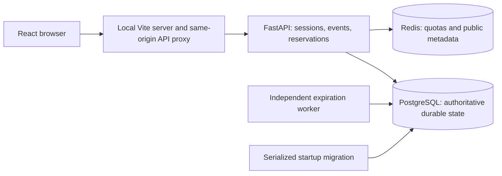

# Concurrency-Safe Reservation System (CSRS)

An event reservation application built to answer a deceptively hard question: **what happens
when many people try to book the last seat at the same time?** CSRS uses PostgreSQL row locks,
atomic transactions, durable retry outcomes, and an independent expiration worker to keep
reservation rows and allocated capacity consistent.

React provides attendee and organizer workflows backed by real FastAPI endpoints. Redis
supports quotas and public metadata caching; PostgreSQL owns every allocation decision.

**Phase 8 scope: local production readiness, final validation, and portfolio evidence.**
The application runs on localhost. It is not cloud-deployed or production-load-tested.
See [Phase 8 validation](docs/phase-8-validation.md) for local evidence and the
[handoff](docs/PROJECT_HANDOFF.md) for publication and exact-commit CI provenance. The owner
selected localhost instead of the older cloud roadmap; future public hosting remains optional.

## Engineering features

- Event-row `SELECT FOR UPDATE` serializes admission across independent API processes.
- One transaction commits the reservation, capacity counter, expiration cleanup, and durable
  idempotency outcome. Same-key retries recover from a lost response without another seat.
- HELD, CONFIRMED, CANCELLED and EXPIRED have explicit state and deadline rules; database
  constraints defend bounds and one active booking per user/event.
- Request-time cleanup and a separate PostgreSQL worker share the event-first lock protocol.
  Worker crashes/restarts rediscover unfinished work; conditional transitions release once.
- Redis quotas are atomic across processes. Public detail caching has SQL visibility checks,
  absolute TTLs and post-commit invalidation. Redis never locks or owns seats.
- Argon2id passwords, opaque database sessions, HttpOnly cookies, synchronizer CSRF tokens,
  exact trusted origins, role/ownership checks and sanitized errors protect mutations.
- React handles session restoration, uncertain retries, countdowns, reservation history,
  organizer event lifecycle, and owner-only booking snapshots.

## Application Screenshots

Captured from the locally running Docker application. CSRS runs locally via
Docker Compose and is not publicly deployed. Browse the [complete screenshot gallery](docs/screenshots/README.md)
for organizer workflows, reservation states, final-seat rejection, security, and responsive layouts.

| Landing page | Organizer booking dashboard |
| --- | --- |
|  |  |
| Confirmed reservation | Final-seat rejection |
|  |  |
| Worker-recorded expiration | Explore the collection |
|  | [Full gallery](docs/screenshots/README.md) · [Coverage and limitations](docs/screenshots/COVERAGE.md) |

## Stack and architecture

React 19 / TypeScript / Vite; Python 3.12 / FastAPI / SQLAlchemy / Psycopg / Alembic;
PostgreSQL 17; Redis 7.4; Docker Compose; Pytest; Vitest / Testing Library;
Playwright Chromium / axe; Ruff / Prettier; GitHub Actions.



See [architecture and transaction diagrams](docs/architecture.md),
[concurrency protocol](docs/concurrency.md), [schema](docs/database.md),
[security contract](docs/security.md), [API contract](docs/contracts/api.md),
and [engineering decisions](docs/decisions.md).

## Start locally

Install Git and Docker Desktop with Linux containers. Start Docker Desktop and wait until
its engine is running. Use Compose v2.24.4+ (the recovery override uses `!reset`). PowerShell 7
runs the convenience scripts; the Compose command works on other shells. Host Python and
Node are optional for the container stack. Reserve ports 5173, 8000, 5432 and 6379.
All published ports bind to `127.0.0.1`.

From the repository root, one command prepares `.env` if absent and starts all five services:

```powershell
./scripts/local.ps1 start
```

The script preserves an existing `.env`. Its first-run copy contains **public local-only
PostgreSQL examples**, never public-deployment credentials. If scripts are unavailable, copy
`.env.example` only when `.env` is absent, then use the equivalent full-stack command:

```powershell
if (-not (Test-Path .env)) { Copy-Item .env.example .env }
docker compose --profile worker up --build -d --wait --wait-timeout 180
```

PostgreSQL becomes healthy, the one-shot `migrate` service upgrades Alembic and checks drift,
then the API and worker start. The frontend waits for API health and has an HTTP health
check. Migrations use a transaction/advisory lock; competing migration attempts time out
visibly rather than racing schema writes. They run in the dedicated service, never each API
process. Repeated startup preserves data. An exited migration container with code 0 is expected.

| Address | Purpose |
| --- | --- |
| [localhost:5173](http://localhost:5173/) | Attendee and organizer application |
| [localhost:8000/docs](http://localhost:8000/docs) | FastAPI interactive documentation |
| [API liveness](http://localhost:8000/api/v1/health/live) | API process responds |
| [API readiness](http://localhost:8000/api/v1/health/ready) | PostgreSQL connectivity |
| [Proxy readiness](http://localhost:5173/api/v1/health/ready) | Browser-to-API path |

Use `localhost:5173` consistently with `CSRS_PUBLIC_ORIGIN`. Readiness checks PostgreSQL
connectivity, not Redis or worker progress. Inspect migration exit status and worker logs:

```powershell
./scripts/local.ps1 status
docker compose logs --tail 20 migrate worker
```

Stop the full stack, including worker/test profiles, while retaining the database volume:

```powershell
./scripts/local.ps1 stop
# Equivalent: docker compose --profile worker --profile test down
```

Never append `--volumes` to ordinary local shutdown. Changing `.env` initialization credentials
does not change passwords inside an existing PostgreSQL volume. API reload is disabled for
stable demonstrations: after backend edits use `docker compose restart backend worker`;
after dependency changes rerun startup with `--build`. Vite remains a **local development
server**, not a hardened public web tier. [Future deployment](docs/FUTURE_DEPLOYMENT.md)
describes the remaining HTTPS hosting and built frontend serving work.

## Configure and demonstrate

[.env.example](.env.example) lists environment/origin, connection URLs, SQL pools/timeouts,
session/hold TTLs, Redis cache/quotas and worker polling/backoff. Compose injects container DNS
URLs; host commands require explicit settings, with no implicit `.env` lookup.
`VITE_API_BASE_URL` is a public same-origin path, normally `/api/v1`, never a credential.
No CORS middleware is enabled; `CSRS_PUBLIC_ORIGIN` is the CSRF trust boundary.
Cookie security/name derive from its scheme; production settings require HTTPS.

Use the [five-minute demo guide](docs/DEMO_GUIDE.md) for UUID-scoped sample account/event
setup, a private password prompt, safe cleanup, troubleshooting and technical demonstrations.
Public registration creates attendees. Existing registered users can be promoted locally
(promotion revokes sessions; log in again):

```text
docker compose exec -T backend python -m csrs.cli promote-organizer EMAIL
docker compose exec -T backend python -m csrs.cli purge-sessions --batch-size 1000
```

The [interview guide](docs/INTERVIEW_GUIDE.md) explains transactions, retries, failure policies
and tradeoffs. [Portfolio evidence](docs/evidence/README.md) identifies actual captures/results,
manual capture instructions and historical CI.

## Verify

Full backend suite with real PostgreSQL and Redis, using disposable test databases:

```powershell
docker compose --profile test run --build --rm backend-test
docker compose exec -T backend python -m ruff check --no-cache .
docker compose exec -T backend python -m ruff format --check --no-cache .
docker compose exec -T backend python -m pip check
docker compose exec -T backend python -m alembic heads
docker compose exec -T backend python -m alembic current
docker compose exec -T backend python -m alembic check
docker compose exec -T backend python scripts/smoke_reservations.py
```

Test PostgreSQL uses port 5433 and generated `csrs_phase2_*_test` databases; test Redis uses
port 6380/database 15 with scoped keys. Fixtures never truncate/drop the configured input
database. Missing host test URLs skip integration; full Compose verification requires real
services. No SQLite substitute establishes PostgreSQL correctness.

With Node.js 24/npm installed, run frontend checks and real Chromium journeys:

```powershell
npm.cmd --prefix frontend ci
npm.cmd --prefix frontend run format:check
npm.cmd --prefix frontend test
npm.cmd --prefix frontend run build
npm.cmd --prefix frontend exec playwright install chromium
npm.cmd --prefix frontend run test:e2e
```

On Linux use `npm` and install Chromium system dependencies with
`npm --prefix frontend exec playwright install --with-deps chromium`.
Run browser tests on a quiet migrated stack. UUID fixtures use the real backend and clean
only scoped rows; failure traces/screenshots stay under ignored test-results.

Controlled restart/outage/persistence checks use a fresh isolated Compose project with no
host ports and a separate named PostgreSQL volume:

```powershell
./scripts/verify-local.ps1
```

It restarts all five services and verifies ordinary down/up, durable sessions/idempotency,
overdue worker recovery and Redis available/outage/recovery. It stops its project afterward
and retains its volumes. It does not interrupt the normal `csrs` project or erase its data.
Read-only invariant SQL is in [reconcile.sql](backend/scripts/reconcile.sql).

[GitHub Actions](.github/workflows/ci.yml) retains backend lint/format/unit/integration,
migration, frontend format/test/build, Compose, reservation, Chromium, worker and Redis checks,
and adds isolated recovery verification. Hosted CI does not run on uncommitted changes.
Exact local results and commands are in the Phase 8 validation report.

## References and limitations

- [Beginner-friendly Phase 8 explanation](docs/phase-explanations/phase-8-explanation.md)
- [Phase 7 validation](docs/phase-7-validation.md) and [explanation](docs/phase-explanations/phase-7-explanation.md)
- [Phase 6 Redis validation](docs/phase-6-validation.md) and [worker validation](docs/phase-5-validation.md)
- [Phase 4 concurrency validation](docs/phase-4-validation.md), [Phase 2](docs/phase-2-validation.md)
  and [foundation validation](docs/phase-1-validation.md)
- [Infrastructure notes](infra/README.md) and [OpenAPI](docs/contracts/api.openapi.yaml)

Event-level locks serialize writes to hot events. Availability/countdowns are advisory.
Correctness tests are not throughput benchmarks. Redis restart resets quotas/cache;
new-session/auth operations fail closed during outages while authenticated commands/public
reads continue through PostgreSQL. No automated backup/restore, public HTTPS, production
monitoring, account recovery/MFA, retention schedule, payments or cloud infrastructure exists.
Chromium/axe checks do not establish full accessibility compliance.

<!-- Historical reports link this stable fragment. -->
<!-- markdownlint-disable-next-line MD033 -->
<a id="redis-support-phase-6-awaiting-review"></a>

## Redis configuration reference

Default quotas per 60 seconds are 30 new anonymous sessions, 10 combined login/register
attempts, 120 public event reads per peer, and 60 booking/organizer commands per user.
Exceeded quotas return 429 plus numeric Retry-After. Required auth limiter failures return
503; optional public/mutation limiter failures continue through SQL. Forwarded headers do
not select peer identity; local proxy users share a peer quota. Existing valid CSRF retrieval,
logout, health and private reads are unthrottled.

Only public event detail metadata is cached (default 15 seconds, maximum 60). Every hit checks
SQL PUBLISHED visibility. Lists, availability, private data and durable idempotency are never
cached. Hits and late fills do not renew metadata beyond its original absolute expiry.
Post-commit invalidation is best effort. Redis is ephemeral, limited to 64 MiB with noeviction;
errors use the documented failure policy. See [Redis architecture](docs/architecture.md#phase-6-redis-boundaries-and-failure-policies).
