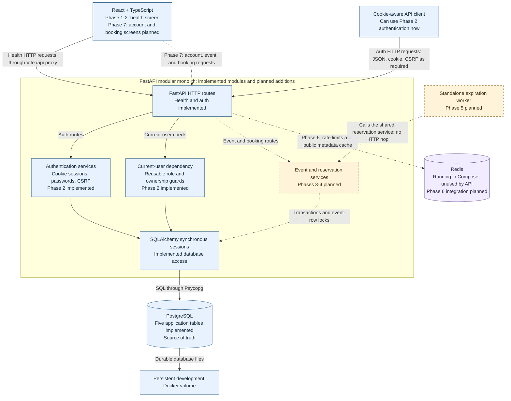
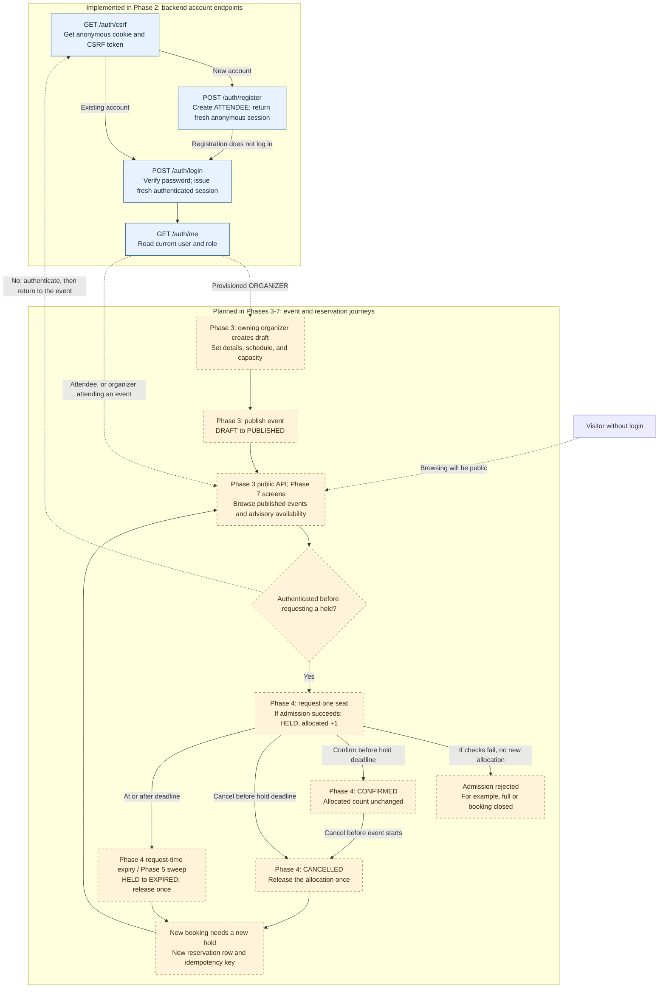
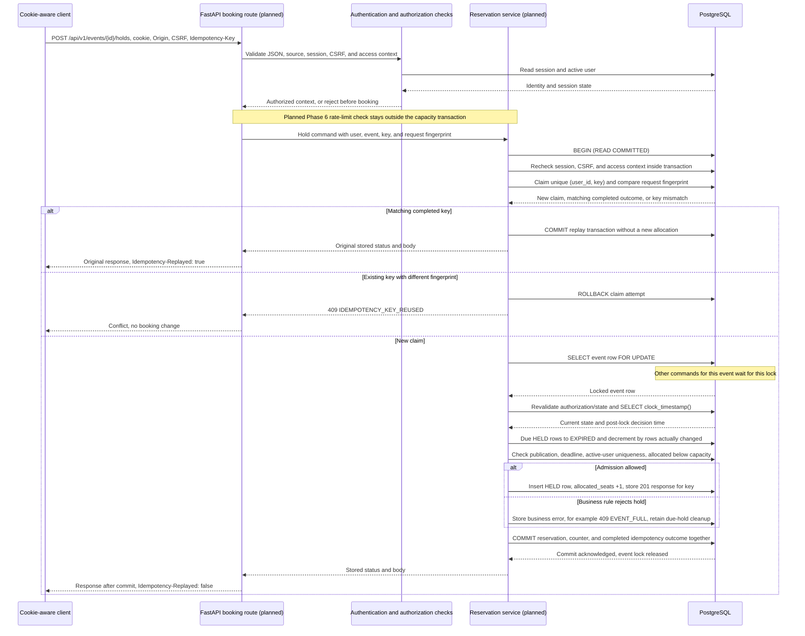

# CSRS architecture

## Implementation boundary

Phase 1 provides configuration, application/engine lifecycle, health checks, React health UI,
and development infrastructure. Phase 2 adds the five-table database foundation, one Alembic
migration, backend authentication, CSRF enforcement, reusable authorization guards, and
local administration commands. Events, booking operations, Redis limiting/caching, and the
expiration worker remain **future contracts**, not implemented features.

## Modular monolith

The React browser client calls `/api/v1` on its own origin. In development Vite proxies
that path to FastAPI without rewriting the browser's Origin header. In the planned deployment,
the backend serves the built frontend from the same origin.

FastAPI handles transport/validation. Domain services will own transaction boundaries and
authorization decisions. SQLAlchemy supplies synchronous sessions and database access.
PostgreSQL owns durable users, sessions, events, reservations, capacity, and idempotency.
Alembic owns schema evolution. Each request/worker transaction gets an independent session;
sessions are never shared across threads or requests. No generic repository framework is needed.

Redis will handle rate limits and short-lived public event metadata only. Its contents never
authorize allocations or decide confirmation validity. It is running in Compose in Phase 1,
but there is no Redis client or cache implementation yet.

A future standalone expiration process uses the same image and reservation service as the API.
It discovers overdue work in PostgreSQL. No Celery, broker, per-reservation timer, or in-process
API scheduler is required. Multiple API processes must remain correct without Python mutexes.

## Health and resource lifecycle

- `GET /api/v1/health/live`: process can answer HTTP; performs no dependency checks.
- `GET /api/v1/health/ready`: acquires a PostgreSQL connection and executes `SELECT 1`.
- PostgreSQL failure returns sanitized `503`, never a DSN, SQL error, or exception traceback.
- Both responses use `Cache-Control: no-store`.
- Engine creation occurs in application lifespan, without opening a connection. Shutdown
  disposes the pool. A database outage therefore does not prevent the process from starting.
- Connection establishment, pool checkout, and SQL statement execution have bounded timeouts.
  These are individual bounds, not a promised total request-latency SLA.
- Readiness does not assert schema currency, Redis availability, or future worker health.

## Configuration

Application variables start with `CSRS_`. Pydantic Settings validates environment variables
when the application factory is called, not during module import. Database and Redis URLs
are required and redacted in settings representations and rendered validation messages.
Only the explicit `postgresql+psycopg` driver is accepted. Production public origins require HTTPS.

There is no implicit `.env` search: Uvicorn's `--env-file .env` loads host development settings;
Compose injects its explicit `env_file`. Tests construct settings or set isolated variables.
`POSTGRES_*` variables configure the container, not the Python settings model.

`CSRS_PUBLIC_ORIGIN` is the browser trust boundary; do not derive trusted origins
from arbitrary Host or forwarded headers. Phase 2 validates source origins and session-bound
CSRF on auth mutations. No CORS middleware is enabled. Frontend `VITE_*` variables
must never contain secrets; API requests use relative same-origin URLs.

## Development and future hosting

Compose runs PostgreSQL 17 with a persistent volume, ephemeral Redis 7.4, FastAPI, and Vite.
The opt-in test profile has a separate disposable PostgreSQL instance and backend test runner.
Host ports bind to `127.0.0.1`. Production containers, provisioning, and credentials are out of scope.

The reviewed future hosting option is a Docker web service, paid managed PostgreSQL,
a small background worker, and managed Redis. Choosing a Redis-compatible Valkey service
instead must be documented accurately. No cloud services are created in this phase.

## Interview explanation

The monolith keeps one deployable backend and one transaction boundary for the important work.
Horizontal API scaling does not change correctness because serialization happens in PostgreSQL.
The event lock is deliberately a contention point for one event; unrelated events use different
rows. We will measure the cost before considering a more complicated inventory design.

See [database design](database.md), [transaction protocol](concurrency.md),
[CSRF/security contract](security.md), [API contract](contracts/api.md), and
[decision records](decisions.md).

## System architecture diagram

This diagram combines the running Phase 1-2 foundation with the planned Phase 3-7 additions.
**Solid arrows show implemented communication; dashed arrows show planned communication.**
Node labels also state the boundary, so the distinction does not depend on color.
The React application currently displays health information only. Authentication is available
through the backend API, but React authentication and booking screens are not implemented.

### How to read the system diagram

- **Frontend:** React builds the browser screen, and TypeScript checks its code's types.
  During development, Vite forwards relative `/api` requests to FastAPI while preserving
  the browser's Origin header. The current screen calls readiness, not the auth endpoints.
- **Backend:** FastAPI receives HTTP requests and validates their format. A modular monolith
  means the backend is one application with separate modules, rather than several network
  services. Planned event and reservation modules will live in that same application.
- **Authentication and authorization:** authentication identifies a user from a valid
  database-backed session. Authorization checks what that user may do. Phase 2 implements
  current-user checks and reusable role/ownership guards; future event routes must actually
  apply those guards to stored resources. An attendee cannot request organizer status in
  registration. A local administrator can promote an existing account through the CLI.
- **SQLAlchemy and PostgreSQL:** SQLAlchemy translates database operations into SQL and
  manages transactions. Psycopg is the driver carrying that SQL to PostgreSQL. A transaction
  groups changes so they commit together or roll back together. PostgreSQL already stores
  users and sessions; event, reservation, and idempotency tables exist but their command
  services do not. A SQLAlchemy database session is different from a user's login session.
- **Redis:** its container runs, but there is no application Redis client yet. Phase 6 plans
  request rate limits and short-lived public event metadata caching. A rate limit restricts
  request frequency; a cache keeps a temporary copy for faster reads. Neither cache values
  nor Redis locks will authorize seats. Live availability is advisory and is not planned
  to be cached.
- **Expiration worker:** Phase 5 plans a separate process using the backend image and shared
  reservation service. It will find overdue work in PostgreSQL and use the same event-locking
  protocol as API commands. It will not call the API over HTTP or require Celery/a broker.
  The worker-to-database path goes through the service and SQLAlchemy, as shown above.

For example, losing Redis must never make an extra workshop seat available. Losing the worker
may delay stored expiration cleanup, but future booking requests will check PostgreSQL time
and reclaim due holds themselves. Those are design requirements for later phases, not verified
reservation behavior in the current application.

## Application workflow diagram

The first group below is implemented backend authentication. The second group describes
**planned** event and reservation behavior; it is not a set of currently working screens.
Phase 3 covers event management/public reads, Phase 4 covers reservation commands and
request-time expiration, Phase 5 adds the worker, Phase 6 adds Redis protections, and Phase 7
adds the user-facing event and booking interface. See [delivery phases](phases.md).

### How to read the application workflow

1. **Create an account or log in:** first get a session-bound CSRF token. CSRF means
   cross-site request forgery: another site trying to make a browser submit an unwanted
   action using its cookies. Registration/login require JSON, a matching cookie/token pair,
   and a trusted Origin or allowed Referer fallback. Login replaces the anonymous session
   with a new authenticated session. All account paths in this diagram have the `/api/v1`
   prefix in actual requests. These backend endpoints are implemented; React forms are not.
2. **Manage an event later:** a provisioned organizer will create a draft and publish it.
   Role and stored event ownership must both be checked. Public registration only creates
   attendees. Published events will become browsable without login, while requesting a hold
   requires authentication. Organizers may also attend events.
3. **Hold a seat later:** a hold temporarily counts as one allocated seat. The planned
   deadline is the earlier of the decision time plus the configured hold TTL (initially
   five minutes) and the event's booking deadline. TTL means time to live. No hold can be
   created if it would already be invalid, even when the displayed availability looked positive.
4. **Confirm or cancel later:** confirming a valid hold changes HELD to CONFIRMED without
   taking a second seat. Cancelling a valid hold, or a confirmed booking before event start,
   releases its seat once. At/after its deadline, a stored HELD row is expired instead of
   confirmed or cancelled. Confirmed reservations do not expire at their former hold deadline.
5. **Expire automatically later:** reservation requests will clean due holds for their event;
   the polling worker will also clean them when no user request arrives. A read will present
   an overdue hold as effectively expired even before cleanup persists that change. Both
   cleanup paths must avoid releasing the same seat twice. Terminal CANCELLED/EXPIRED rows
   remain history; rebooking creates a new row rather than reactivating them.

For a workshop with ten seats, an accepted hold will temporarily consume one of those ten.
Confirmation will preserve that allocation. Cancellation or expiration will return it.
The browser's availability display will be a snapshot, not a guarantee that a later hold wins.
Phase 6 rate limiting/caching will support these flows without replacing the database checks.

The diagram omits some planned actions to stay readable: organizers will also close events
and edit permitted capacity/metadata. Event status changes and capacity edits must take the
same event lock. Closing stops new holds but does not invalidate an otherwise valid existing
hold. All these event/reservation actions remain unimplemented at the end of Phase 2.

## Concurrency-safe reservation workflow

**The following sequence is the planned Phase 4 hold-creation protocol, not implemented code.**
Its database foundation, READ COMMITTED engine setting, and authentication helpers exist in
Phase 2. The reservation transaction, event-row locking, idempotency service, and capacity
updates still need implementation and concurrency tests. Phase 5 will reuse the locking
rules for the worker; Phase 6 will add rate limiting before the capacity transaction.

### Why this transaction is planned this way

- **Authenticate before a booking:** identify the user and reject malformed/forged requests
  before allocating anything. Future mutation services must also validate the session/CSRF
  inside their transaction and recheck authorization against stored state. The current
  read-only role dependency alone is insufficient for implementing a mutation. Authentication,
  CSRF, ownership where applicable, and throttling still apply before an idempotent replay.
- **Claim the idempotency key first:** idempotency means a retry does not create another
  effect. The existing PostgreSQL unique constraint on `(user_id, key)` will arbitrate
  competing claims. A fingerprint describes the method, canonical path, and validated body.
  Matching completed requests replay their original response; a different fingerprint
  with the same key receives 409. A competing duplicate waits for the original transaction;
  if that transaction rolls back, the claim can be retried. No pending claim is committed
  independently, and replay must not repeat the business mutation.
- **Lock one event:** `SELECT ... FOR UPDATE` locks the event row until the transaction
  finishes. READ COMMITTED is the isolation level controlling what committed data each SQL
  statement can observe; it does not by itself prevent overbooking. The explicit row lock
  orders changes for that event across API processes and the future worker. Requests for
  unrelated events use different rows. Lock order is idempotency claim, event, reservation
  rows. Confirm/cancel must discover the immutable event ID before locking and then reread
  the reservation/ownership after the event lock; they must not lock a reservation first.
- **Check time after waiting:** sample PostgreSQL `clock_timestamp()` after obtaining the
  lock. Transaction-start `now()` may be stale after a wait. Hold validity is strictly
  `decision_time < hold_expires_at`; equality is expired. All decisions in the command use
  that instant, even if the commit happens slightly later. Browser clocks do not decide.
- **Update the rows and counter together:** expire due holds, check admission, then insert
  the new hold and increment the counter in the same transaction. The intended invariant is
  `allocated_seats = count(persisted HELD) + count(CONFIRMED)`, with
  `0 <= allocated_seats <= capacity`. An invariant is a rule that must remain true.
  The implemented CHECK only bounds the stored counter; it cannot enforce cross-table
  equality or guarantee no overbooking without the future transaction service.
- **Commit before replying:** PostgreSQL must commit the reservation changes, counter, and
  completed idempotency response before the API reports success. Useful expiry cleanup
  and a business conflict can commit together; raising an exception that rolls everything
  back would undo that cleanup. Infrastructure failures instead roll back the transaction
  and do not become stored completed booking outcomes. No Redis calls, remote I/O, or slow
  password work belong inside the event-lock transaction.

For example, suppose nine of ten seats are allocated and two attendees request the last
seat. The first future transaction locks the event, sees nine, and commits ten. The second
waits, then sees ten after obtaining the lock and returns a stored EVENT_FULL conflict
unless a due hold has made room. Neither request may admit using a previously cached count.
This is the intended correctness argument, not a race test already passed by Phase 2.

If a response is lost after a successful commit, the client must retry with the **same key**
to retrieve the original outcome. A connection failure during commit leaves the outcome
uncertain; creating a new key could duplicate intent. Replayed bodies describe the original
outcome, so the client should then fetch the current resource state. Lock timeout/transient
database failures require rollback and a retryable response, not a completed business error.

Confirmation will change HELD to CONFIRMED without increasing the counter. Cancellation and
expiration will decrement only when they actually transition a counted row. Capacity edits
and publication/closing must participate in the same event-lock protocol. Future concurrent
and failure-injection tests must check both counter bounds and cross-table equality using
real PostgreSQL; the current schema/authentication tests do not establish those guarantees.
