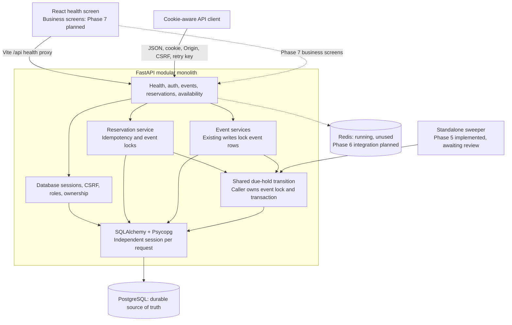
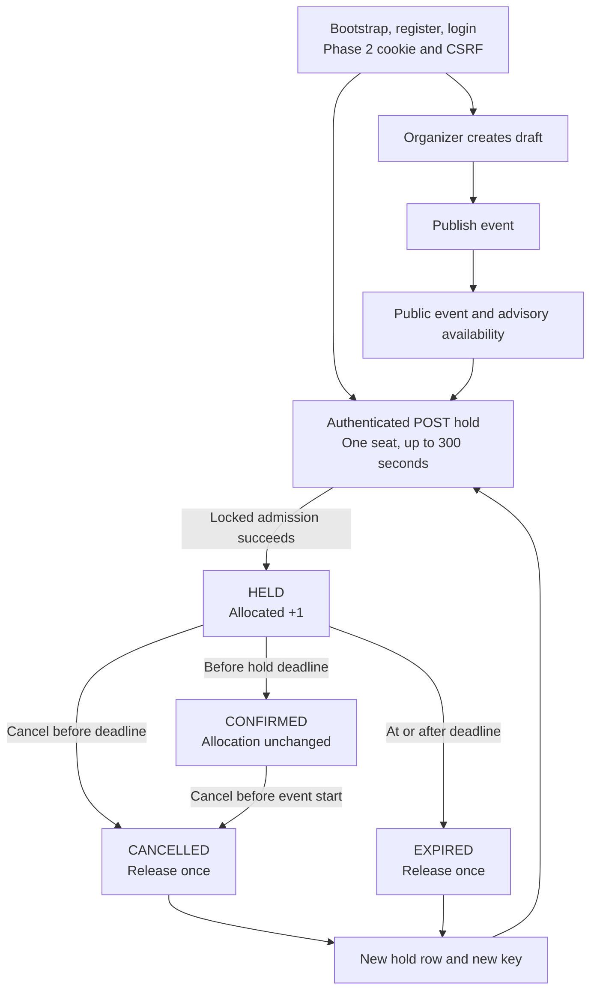
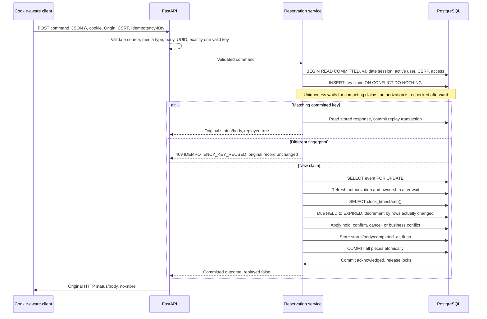
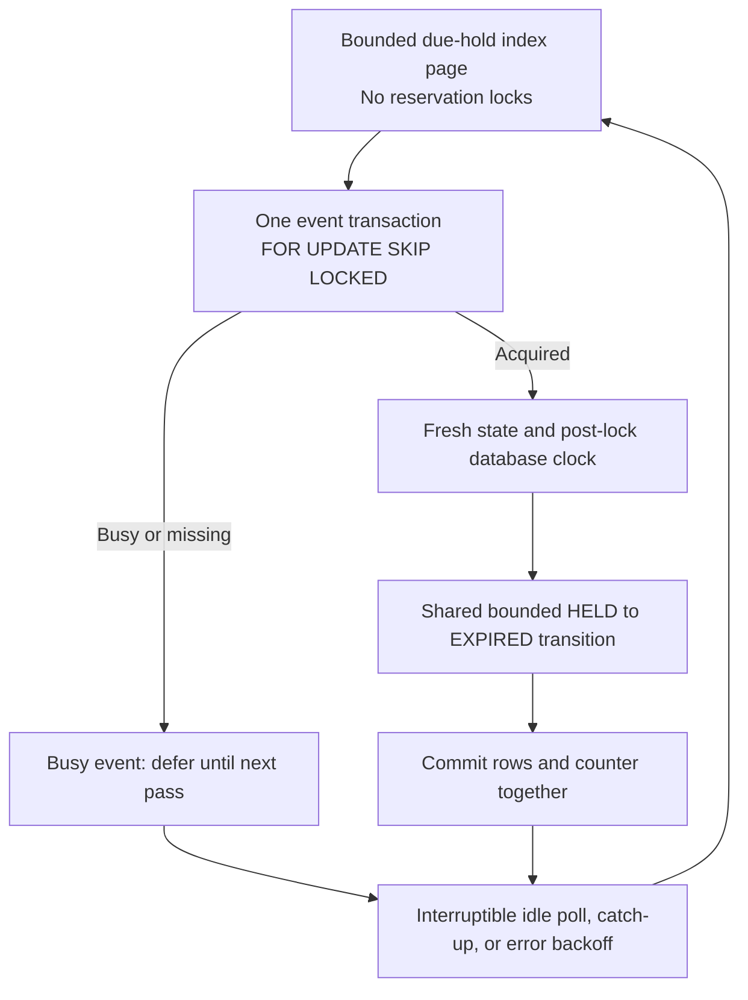

# CSRS architecture

## Implementation boundary

Phase 1 provides configuration, application/engine lifecycle, health checks, React health UI,
and development infrastructure. Phase 2 adds the five-table database foundation, one Alembic
migration, backend authentication, CSRF enforcement, reusable authorization guards, and
local administration commands. Phase 3 adds public event discovery and owner-only event
create/read/edit/capacity/publish/close operations with event-row locks. Phase 4 adds holds,
confirmation/cancellation, request-time expiration, durable idempotency, owner history/detail,
and public advisory availability. Phase 5 adds the standalone expiration worker, bounded
index-backed cleanup, and recovery tests; it is implemented locally and awaiting review. Redis
limiting/caching, organizer dashboard, business UI, and deployment remain **future work**.
See [Phase 4 validation](phase-4-validation.md) and [Phase 5 validation](phase-5-validation.md)
for actual PostgreSQL correctness evidence and each phase's review status.

## Modular monolith

The React browser client calls `/api/v1` on its own origin. In development Vite proxies
that path to FastAPI without rewriting the browser's Origin header. In the planned deployment,
the backend serves the built frontend from the same origin.

FastAPI handles transport/validation. Authentication/event/reservation services own transaction
boundaries and
authorization decisions. SQLAlchemy supplies synchronous sessions and database access.
PostgreSQL owns durable users, sessions, events, reservations, capacity, and idempotency.
Alembic owns schema evolution. Each request/worker transaction gets an independent session;
sessions are never shared across threads or requests. No generic repository framework is needed.

Redis will handle rate limits and short-lived public event metadata only. Its contents never
authorize allocations or decide confirmation validity. It is running in Compose in Phase 1,
but there is no Redis client or cache implementation yet.

The standalone expiration process uses the same backend image and shared transition as the API.
Run `python -m csrs.worker` or the opt-in Compose worker service. It discovers overdue work
in PostgreSQL. No Celery, broker, per-reservation timer, or in-process
API scheduler is required. Multiple API processes must remain correct without Python mutexes.

## Health and resource lifecycle

- `GET /api/v1/health/live`: process can answer HTTP; performs no dependency checks.
- `GET /api/v1/health/ready`: acquires a PostgreSQL connection and executes `SELECT 1`.
- PostgreSQL failure returns sanitized `503`, never a DSN, SQL error, or exception traceback.
- Both responses use `Cache-Control: no-store`.
- Engine creation occurs in application lifespan, without opening a connection. Shutdown
  disposes the pool. A database outage therefore does not prevent the process from starting.
- Connection establishment, pool checkout, and SQL statement execution have bounded timeouts.
  These are individual bounds, not a promised total request-latency SLA.
- Readiness does not assert schema currency, Redis availability, or worker progress.

## Configuration

Application variables start with `CSRS_`. Pydantic Settings validates environment variables
when the application factory is called, not during module import. Database and Redis URLs
are required and redacted in settings representations and rendered validation messages.
Only the explicit `postgresql+psycopg` driver is accepted. Production public origins require HTTPS.

There is no implicit `.env` search: Uvicorn's `--env-file .env` loads host development settings;
Compose injects its explicit `env_file`. Tests construct settings or set isolated variables.
`POSTGRES_*` variables configure the container, not the Python settings model.

`CSRS_PUBLIC_ORIGIN` is the browser trust boundary; do not derive trusted origins
from arbitrary Host or forwarded headers. Phase 2 validates source origins and session-bound
CSRF on auth mutations. No CORS middleware is enabled. Frontend `VITE_*` variables
must never contain secrets; API requests use relative same-origin URLs.

## Development and future hosting

Compose runs PostgreSQL 17 with a persistent volume, ephemeral Redis 7.4, FastAPI, and Vite.
The opt-in test profile has a separate disposable PostgreSQL instance and backend test runner.
Host ports bind to `127.0.0.1`. Production containers, provisioning, and credentials are out of
scope.

The reviewed future hosting option is a Docker web service, paid managed PostgreSQL,
a small background worker, and managed Redis. Choosing a Redis-compatible Valkey service
instead must be documented accurately. No cloud services are created in this phase.

## Interview explanation

The monolith keeps one deployable backend and one transaction boundary for the important work.
Organizer and reservation writes serialize through the same PostgreSQL event-row lock.
The event lock is deliberately a contention point for one event; unrelated events use different
rows. We will measure the cost before considering a more complicated inventory design.

See [database design](database.md), [transaction protocol](concurrency.md),
[CSRF/security contract](security.md), [API contract](contracts/api.md), and
[decision records](decisions.md).

## System architecture diagram

Solid arrows show implemented communication. Dashed arrows show future work. The browser
still displays health only; cookie-aware clients can use the implemented business APIs.

Redis never decides capacity. The worker locks each event before calling shared cleanup; the
helper neither claims a key nor commits. Request-time cleanup still works when no worker runs.
The five-table schema is unchanged; Phase 5 adds the partial event/expiry/ID index in revision
`0002_worker_expiry` to bound cleanup work within a large event.

## Application workflow diagram

These are implemented backend transitions. React account/event/booking screens remain Phase 7.

Closing an event blocks new holds without invalidating existing valid holds. Confirmed rows
never expire at the old hold deadline. Repeat confirm/cancel follow the state table in
[concurrency.md](concurrency.md). GET projects overdue HELD as effective EXPIRED without a write.
History stays private and uses `(created_at,id)` keyset pagination; availability is public for
PUBLISHED events, with one SQL snapshot and one database time sample, and remains advisory.

## Concurrency-safe reservation workflow

This sequence is implemented in Phase 4. Rate limiting before the transaction remains Phase 6.
For confirm/cancel, the service first discovers the immutable event ID with an unlocked,
owner-scoped reservation read. No reservation lock precedes the event lock.

A flush sends SQL without committing. Business conflicts are values so useful expiration and
the stored conflict can commit together. Security/validation exceptions and database failures
roll back the new claim and changes. Missing/foreign resources return 404 without completing
an outcome. No remote call or password hashing occurs inside this lock.

The serialization point is the event row: if two users want the last seat, the waiter reads
fresh committed capacity after the winner commits. Every admitted hold adds one counted row
and one counter unit. Confirmation preserves the count; cancellation/expiry release only on
an actual transition. The invariant includes overdue **persisted** HELD rows until cleanup:

`allocated_seats = count(persisted HELD + CONFIRMED)`, within `[0, capacity]`.

The database CHECK bounds the counter; application protocol plus independent SQL checks prove
cross-table equality for the tested scenarios. Arbitrary administrator writes can violate it.
Capacity edits use the same due-hold helper and lock, committing cleanup even on a refused
reduction. All transactions cover one event; no reverse lock order or multi-event write exists.

A decision uses PostgreSQL actual time **after** the lock; transaction-start `now()` could
predate a wait. Equality at expiration is expired. A valid confirmation uses that decision
instant even if commit occurs later. Reservation output normalizes timestamps to UTC.

Idempotency fingerprints POST, canonical UUID path, and validated `{}`. `(user_id,key)`
uniqueness arbitrates across processes. The claim and completed outcome commit together; a
rolled-back claim is reusable. Records are retained in this MVP. A response lost after commit
or connection lost during commit requires the **same key**; no automatic server retry or new
key is generated. 503 transient failures are not stored. Replayed responses can be stale;
clients fetch the current reservation afterward.

## Phase 5 worker and recovery

The independent worker has no HTTP listener, user session, CSRF, retry key, or Redis call.
It discovers at most CSRS_WORKER_BATCH_SIZE due reservation index entries per cycle without
locking reservations, deduplicates their event IDs, then opens one transaction per event.
It selects that event FOR UPDATE SKIP LOCKED with refreshed state and samples clock_timestamp
only after locking. Shared cleanup expires at most the configured batch size for that event.
Reservation updates and counter decrement commit atomically. APIs keep their existing cleanup
behavior and response contracts; the worker's row limit is optional on the shared helper.

Discovery orders (hold_expires_at,event_id) using the existing partial due-hold index. A fixed
cutoff bounds a pass while new holds become due; a keyset position advances past busy groups
and wraps when the pass ends. Equal-deadline rows from the same event may be skipped within a
pass, because that event is already a candidate; later passes reclaim remaining bounded chunks.
This prevents one busy oldest event from blocking discovery of later events. The position is
navigation only: restarting from the oldest work is safe, and PostgreSQL retains all unfinished
work. Cleanup orders (hold_expires_at,id) under the event lock using the new event-first partial
index. Static HELD predicates keep these partial indexes eligible for generic prepared plans.

SIGTERM/SIGINT interrupt idle/backoff waits and request stop between event transactions. An
active transaction finishes before clean exit; forced termination rolls it back. Restart
rediscovers committed HELD rows. Duplicate/stale processing cannot release terminal or confirmed
rows again. Recoverable database errors roll back, emit sanitized JSON, and retry with capped
exponential backoff. Failures within a cached page are paced too, allowing later candidates to
progress without a tight reconnect loop. Unexpected errors terminate with a sanitized failure
record; Compose restart policy is unless-stopped. Startup never runs migrations automatically.
