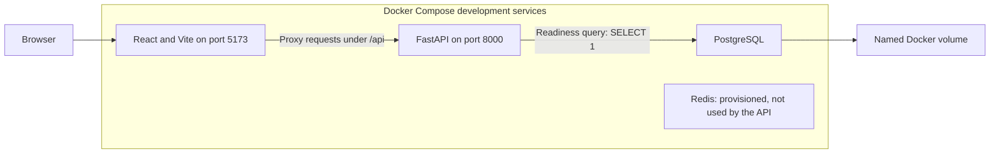
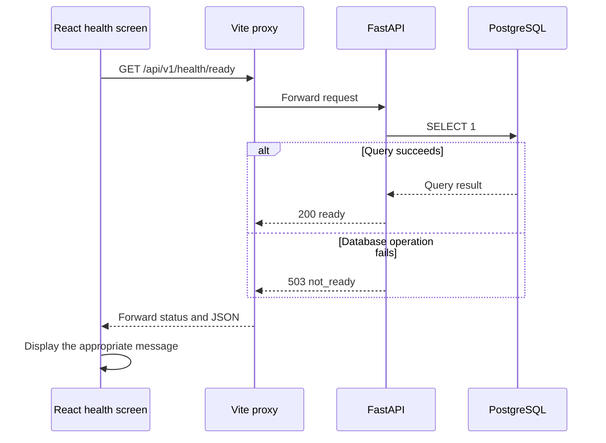

# Phase 1 explained: project foundation

This guide explains the application as it stood at the end of Phase 1, including its
completed Docker/PostgreSQL verification. The Phase 1 snapshot is commit
`cc4f3df452e2ce49ca5d496705d44d38543499e1`.
Some files named below were expanded during Phase 2. Their current contents should not be
mistaken for features that already existed in Phase 1.

For the next phase, read [Phase 2 explained](phase-2-explanation.md).
For recorded commands and results, use the existing
[Phase 1 validation report](../phase-1-validation.md). This guide explains that evidence;
it does not replace or reproduce the report.

## 1. Phase overview

The eventual CSRS application will let people reserve seats for events and workshops.
Its main engineering goal is to avoid overbooking when many people act at the same time.
**Phase 1 did not implement seat reservations.** It established a reliable place to build them.

The **backend** is the server-side program. The **frontend** is the browser-facing part.

Imagine developing a workshop application on two laptops. If they use different database
versions or configuration, a feature might work on one laptop and fail on the other.
If the API stops working, it might also be unclear whether the API or database is responsible.

Phase 1 addressed these preparation problems. It provided a consistent development setup,
a small working backend and frontend, configuration checks, health checks, documentation,
and an automated verification pipeline.

An **API**, or application programming interface, is how another program asks the backend
to do something. In this phase, the API could answer health questions only.
**HTTP** is the request/response protocol used for that communication.

## 2. What we implemented

### One repository with clear responsibilities

A **monorepo** keeps related parts of a project in one Git repository. CSRS separated backend,
frontend, documentation, tests, migrations, and infrastructure notes into clear locations.
This makes it easier to find code and review changes without creating separate services
for every feature.
Git records file versions; a repository contains the project and its tracked history.

The backend architecture is a **modular monolith**: one backend application with organized
modules. It is intended to keep future reservation changes inside one database transaction,
rather than coordinating them across several network services.

### A minimal FastAPI backend

The backend used an application factory, `create_app()`, which constructs a FastAPI
application from validated settings. A factory also lets tests create their own application
instances without depending on a running development server.

It exposed two health endpoints. One checks whether the process can answer HTTP requests;
the other checks whether PostgreSQL can answer a small SQL query.
**SQL** is the language used to ask a relational database for data or make changes to it.

### Validated environment configuration

An **environment variable** is a value supplied to a running program from outside its code.
Examples include the database connection URL and the expected frontend origin.
CSRS reads application settings with the `CSRS_` prefix and validates them before use.

For example, an SQLite URL is rejected because this project deliberately uses PostgreSQL.
Invalid pool sizes and malformed configuration also fail early, rather than causing a
mysterious error during a later request.

The repository supplies `.env.example` as a local configuration template. The actual `.env`
file is ignored by Git. Settings do not silently search for an environment file: Compose
injects it explicitly, and the documented host Uvicorn command loads it explicitly.

### A React health screen

The frontend was a working React and TypeScript application, not a booking interface.
It checked readiness when the page loaded and when the user clicked **Check again**.

It could distinguish these situations:

- The check is still running.
- The API and PostgreSQL are ready.
- The API responds, but PostgreSQL is unavailable.
- The frontend cannot obtain a usable response from the API.

The request has a ten-second client timeout. Leaving the component also cancels its request
and prevents a late response from updating a screen that is no longer active.
There was no continuous background polling or real-time event availability display.

### Docker development and separate database testing

A **container** packages a program with the runtime it needs. Docker Compose describes how
several containers run together.

The ordinary development setup contained FastAPI, Vite/React, PostgreSQL, and Redis.
An optional Compose test profile added a separate PostgreSQL service and a backend test runner.
This avoids using development data as disposable test data.

Redis was running and had its own health check, but the application did not use it for
caching, rate limiting, sessions, or capacity decisions.
A **cache** keeps temporary copies of data for reuse. A **rate limiter** restricts how
frequently requests can be made. Both integrations were future work.

### Written contracts and CI

A **contract** describes expected behavior: endpoint paths, response formats, state rules,
and component responsibilities. Phase 1 recorded future authentication and reservation
decisions before implementing those features.

**Continuous integration**, or CI, means running automated checks when code is pushed or
reviewed. GitHub Actions was configured to check the backend, build the frontend, and
exercise the Docker setup. A dependency-update configuration was also added; it does not
automatically approve or merge upgrades.

## 3. Technologies used

| Technology | Actual role in Phase 1 |
| --- | --- |
| Python 3.12 | Language used for the backend and tests |
| FastAPI | Defines HTTP routes and response schemas |
| Uvicorn | Runs the FastAPI application as an HTTP server |
| Pydantic and Pydantic Settings | Validate response data and environment configuration |
| SQLAlchemy | Creates the PostgreSQL engine and manages pooled connections |
| Psycopg | Driver that actually communicates with PostgreSQL |
| PostgreSQL | Real database used by readiness and integration tests |
| Alembic | Migration framework prepared for later schema changes |
| React and TypeScript | Render the health screen with checked frontend types |
| Vite and Node.js | Run the frontend development server and produce its build |
| Redis | In-memory key/value store; provisioned without application integration yet |
| Docker and Compose | Run the development services and isolated test services |
| Pytest and HTTPX2-backed TestClient | Test configuration and HTTP behavior |
| Ruff | Checks Python style, likely mistakes, and formatting |
| Git, GitHub, and GitHub Actions | Track changes, publish the repository, and run CI |

These tools solve different problems. For example, SQLAlchemy manages database access;
it does not replace the PostgreSQL server. TypeScript catches frontend type mistakes;
it does not prove that PostgreSQL is reachable.

## 4. How everything works

### Development architecture



The unconnected Redis node is intentional. There was no API-to-Redis data flow in Phase 1.

### Startup, step by step

1. Compose reads the development configuration and starts the database and Redis services.
2. PostgreSQL and Redis report their own health status.
3. The backend waits for PostgreSQL's Compose health condition before starting.
4. Uvicorn calls `create_app()` to construct the API.
5. FastAPI's **lifespan** code creates the SQLAlchemy engine. Lifespan means startup and
   shutdown resource management.
6. The frontend development server starts after the backend container has started.
7. Opening the React page triggers its readiness request.

An SQLAlchemy **engine** manages database connectivity, including a **connection pool**:
a group of connections that can be reused. Constructing the engine does not immediately
open a database connection. The first database operation needs the actual connection.
On shutdown, the application disposes of the pool.
The readiness query `SELECT 1` asks PostgreSQL to return the constant value one; it does not
read a future event table.

### A readiness request, step by step



A **proxy** forwards a request to another server. The browser calls a relative `/api` URL
on the frontend origin, and Vite forwards it to FastAPI. An **origin** is the combination
of a URL's scheme, host, and port, such as `http://localhost:5173`.
This same-origin arrangement also prepared a simpler cookie setup for Phase 2.

Inside Compose, the database hostname is the service name `postgres`. A host-side program
uses the published local port instead. `localhost` inside the backend container refers to
that container, not the PostgreSQL container.

### A practical failure example

Suppose PostgreSQL becomes unavailable. FastAPI can still return a liveness response because
that endpoint does not query the database. Readiness returns a sanitized `503` response.
The frontend can then show that the API is running but the database is unavailable.

The backend does not return a raw database exception or connection URL to explain this failure.

## 5. Important files and folders

Paths in this table are relative to the repository root. Existing source files may now
contain Phase 2 additions; the phase snapshot identified at the top shows their earlier state.

| Repository-relative path | Purpose |
| --- | --- |
| `backend/src/csrs/main.py` | Application factory and engine lifespan |
| `backend/src/csrs/config.py` | Validated environment settings |
| `backend/src/csrs/database.py` | PostgreSQL engine and connection-pool configuration |
| `backend/src/csrs/api/health.py` | Liveness/readiness routes and response models |
| `backend/migrations/` | Alembic scaffolding; no application revision existed in Phase 1 |
| `backend/pyproject.toml` | Python requirements and Pytest/Ruff settings |
| `backend/requirements-dev.lock` | Resolved dependency constraints for development/tests |
| `backend/tests/unit/` | Fast configuration, health, and contract checks |
| `backend/tests/integration/test_postgres_health.py` | Real PostgreSQL connectivity/isolation tests |
| `frontend/src/App.tsx` | Health screen and request lifecycle |
| `frontend/src/api/health.ts` | Fetches and checks readiness responses |
| `frontend/vite.config.ts` | Frontend server and `/api` proxy |
| `frontend/package-lock.json` | Exact npm dependency resolution |
| `backend/Dockerfile` and `frontend/Dockerfile` | Development/test container images |
| `compose.yaml` | Services, startup conditions, ports, volumes, and test profile |
| `.env.example` and `.gitignore` | Configuration template and local-file exclusions |
| `.github/workflows/ci.yml` | Backend, frontend, and Compose CI jobs |
| `.github/dependabot.yml` | Scheduled dependency-update configuration |
| `docs/contracts/health.openapi.yaml` | Machine-readable health API description |
| `docs/architecture.md`, `docs/concurrency.md`, `docs/decisions.md` | Architecture and future design decisions |
| `README.md` and `infra/README.md` | Setup commands and infrastructure explanations |

## 6. API endpoints

HTTP status codes describe the result of a request. `200` means success; `503` means the
service cannot currently satisfy the readiness check.
**JSON** is the structured text format used for these response bodies.

### Liveness

Request:

```http
GET /api/v1/health/live
```

Response: `200 OK`.

```json
{"status": "alive"}
```

This answers: "Can this API process answer a request?" It does not check PostgreSQL,
Redis, application tables, or future booking logic.

### Readiness

Request:

```http
GET /api/v1/health/ready
```

When PostgreSQL answers the `SELECT 1` query, the response is `200 OK`:

```json
{"status": "ready", "dependencies": {"postgresql": "up"}}
```

When a database operation fails, the response is `503 Service Unavailable`:

```json
{"status": "not_ready", "dependencies": {"postgresql": "down"}}
```

Both endpoints send `Cache-Control: no-store`. This asks clients and intermediaries not to
store the response and accidentally show an old health result.

FastAPI also supplied `/docs` for interactive API documentation and `/openapi.json` for the
machine-readable specification. Those are framework documentation URLs, not booking features.
The React page was served at `http://localhost:5173` during local development.

## 7. Database design

**The application schema had not yet been implemented in Phase 1.** A **schema** describes
tables, columns, and rules for application data. There were no CSRS user, session, event,
reservation, or idempotency tables at this point.

PostgreSQL itself was installed and running in a container. It had its ordinary system
catalogs, which describe the database server's own objects. That is different from having
application tables.

Alembic was prepared, but its revision directory contained no application migrations.
A **migration** is a versioned instruction for changing a database structure.
At the end of Phase 1, `alembic heads` therefore printed no application revision.

The development database used a named Docker volume. Normal container stop/start preserves
that volume. The separate `postgres-test` service used temporary storage for testing.
The two Phase 1 PostgreSQL integration tests were read-only; the generated per-run database
fixtures belong to Phase 2.

An **isolation level** controls what concurrent database work can observe.
The engine selected **READ COMMITTED**, under which a statement reads committed data.
Choosing it did not implement locking or prevent booking races.
The planned per-event row-lock strategy was documented, not executed by any booking endpoint.

## 8. Security and correctness

Phase 1 implemented several foundation protections:

- Local environment files, virtual environments, package caches, and build output were
  excluded from Git. The example configuration contained public local examples only.
- Database/Redis settings were treated as secrets in settings representations, and rendered
  configuration errors did not print their supplied values.
- Database health failures returned a small controlled response instead of exception details.
- Host-published service ports were bound to `127.0.0.1`, a **loopback** address for the
  local computer. This limits their host-network exposure as configured.
- The images ran the application commands as non-root users.
- Connection establishment, pool checkout, and SQL execution had timeout controls.
- Frontend code checked the response body at runtime, because TypeScript types alone cannot
  guarantee what a remote server actually returns.

Authentication, role enforcement, password hashing, and CSRF enforcement were not implemented
in this phase. **CSRF**, or cross-site request forgery, is an attack that tries to make a
browser perform an unwanted action using its cookies. Phase 1 documented how anonymous and
authenticated CSRF protection would work; Phase 2 implemented it.

Readiness did not check migration currency or Redis, and the frontend had no configured
Docker health probe. Its availability was verified through HTTP instead.

## 9. Testing and verification

The completed Phase 1 result was **24 passing tests, with exit code 0**:

- **22 unit/contract cases:** settings validation, secret redaction, health responses,
  engine disposal, and agreement between runtime health schemas and their documented contract.
- **2 PostgreSQL integration cases:** readiness against real PostgreSQL and verification
  that the server was PostgreSQL with READ COMMITTED isolation.

A **unit test** checks a small behavior in isolation. Some health unit tests used a fake
engine so they could force success/failure. An **integration test** checks components
working together; the two database integration tests used real PostgreSQL, not SQLite.

Docker startup, backend lint/format checks, dependency consistency, the TypeScript/Vite build,
HTTP endpoints, and the Vite proxy were also verified. The original GitHub Actions workflow
completed successfully, as recorded in the validation report.

The persistence check compared the existing cluster identity, database/catalog fingerprints,
and volume before and after a PostgreSQL restart. The server start time changed while the
existing cluster and catalog information remained. No application marker table or data was
created for the check. This verified existing cluster/catalog persistence across that restart;
it was not a business-data backup/restore or disaster-recovery test.

An earlier host-only run had skipped the database tests because Docker was unavailable.
The final 24-test PostgreSQL run resolved that limitation.

See the [original validation report](../phase-1-validation.md) for detailed evidence.
Running the current repository's suite executes the expanded Phase 2 tests, not the historical
24-test snapshot. Neither test count is a throughput benchmark or proof of booking correctness.

## 10. What was NOT implemented yet

At the end of Phase 1, the project did not provide:

- Application tables or a schema migration.
- Registration, login, logout, sessions, or role checks.
- Event creation, organizer dashboards, or booking history.
- Holds, confirmation, cancellation, or expired-hold processing.
- Reservation idempotency or an implemented overbooking-prevention transaction.
- Redis caching or rate limiting.
- Celery, background workers, payments, email, or a public cloud deployment.
- Browser booking forms or an authentication interface.

**Idempotency** means that repeating the same operation does not create a second effect.
Its reservation design was documented for later implementation, not delivered here.

## 11. Interview preparation

### What did you actually deliver in Phase 1?

A runnable backend/frontend foundation with PostgreSQL, a provisioned Redis container,
health endpoints, validated configuration, Docker development, tests, CI, and architecture
contracts. I did not deliver reservation operations in this phase.

### Why use a modular monolith?

It keeps the project understandable and leaves future booking changes inside one database
transaction. Several microservices would add deployment and coordination work before it
helped this student-sized application.

### Why separate liveness and readiness?

They answer different questions. A running API process may still be unable to reach its
database. The distinction helps identify failures without treating every dependency outage
as a dead process.

### Why not use SQLite for integration testing?

The project is designed around PostgreSQL behavior. SQLite would not exercise the same
driver, isolation behavior, or later PostgreSQL row locks.

### Does a passing readiness check prove the schema is correct?

No. The check executes `SELECT 1`. It proves basic database connectivity/query execution,
not the presence of application tables or the success of future booking operations.

### Why run Redis before using it?

It prepared the development environment for later rate limiting/caching. The tradeoff is
one extra local service. The application still had no Redis integration or correctness
dependency on Redis.

### What does a Docker volume solve?

It separates persisted database files from a container's lifecycle. Replacing a container
does not require reinitializing the database when the existing named volume is retained.

### What do 24 passing tests prove?

They provide repeatable evidence for the specific foundation behaviors tested. They do not
prove that an unimplemented booking engine prevents overbooking.

### What was the most important tradeoff?

Keeping the first phase small made failures easier to isolate. The cost was deliberately
postponing visible booking features until the environment and contracts were verified.

## 12. Phase summary

Phase 1 created a working development foundation for CSRS.
The backend could report whether it was alive and whether PostgreSQL was reachable.
The React page displayed that readiness result.
Docker Compose organized the local services and a separate database test setup.
The completed phase had 24 passing tests and additional infrastructure checks.
Application tables, authentication, and reservation operations were still future work.
