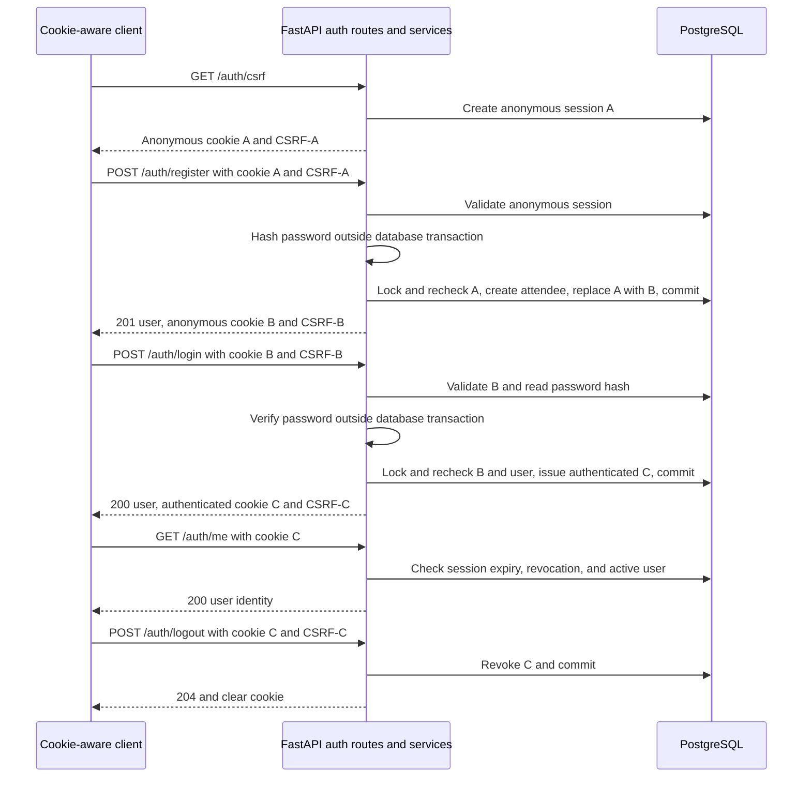

# Phase 2 explained: database schema and secure authentication

This guide describes the Phase 2 implementation committed as
`4b7aaa8d4628b55b122692a62f0ff48b61d87410`.
Read [Phase 1 explained](phase-1-explanation.md) first if the development setup is unfamiliar.

The existing [Phase 2 validation report](../validations/phase-2-validation.md) contains detailed evidence.
It was written before the implementation commit and retains that historical review wording.
The implementation was subsequently approved, committed, and pushed. This explanation does
not move or edit that record.

## 1. Phase overview

Phase 1 made the application runnable and testable. Phase 2 gave it a database structure
and a way to recognize users safely.

Imagine a future workshop reservation request. The server will need to know who is acting,
whether the person is allowed to manage an event, and where to store the event and reservation.
It must not accept a request that simply claims, "I am an organizer."

Phase 2 addressed those identity and storage foundations. **Authentication** answers
"Who is this user?" **Authorization** answers "What may this user do?"
It did not implement event management or seat-booking operations.

## 2. What we implemented

### Five database models and a real migration

An SQLAlchemy **model** describes a database table in Python. Phase 2 added models for users,
sessions, events, reservations, and idempotency records.

An Alembic **migration** creates the actual PostgreSQL tables, constraints, and indexes.
This is more reliable than manually creating a slightly different schema on every laptop.

Only users and sessions are used by the new authentication workflows. Event, reservation,
and idempotency tables are foundations for later services, not evidence of finished booking APIs.

### Registration and safe password storage

Registration validates an email/password request and creates an `ATTENDEE` account.
Extra fields such as role, user ID, or active status are rejected.

The password is stored as an **Argon2id hash**, not readable text. A hash is a one-way result
used for verification; it is not encryption that the application can later decrypt.
Registration does not automatically log the new user in.

### Login and server-managed sessions

A **session** is a server-side record that lets later requests identify a user after login.
The client receives a random secret in a cookie. PostgreSQL stores a hash of that cookie
secret, the associated user, expiration information, and a separate CSRF token.

A cookie is a small value a browser can automatically send with matching requests.
This design makes server-side logout/revocation straightforward: the server stops accepting
the session even if someone tries to reuse an old cookie.

### CSRF protection before and after login

**Cross-site request forgery**, or CSRF, tries to make a victim's browser submit an unwanted
request using its cookies. Login can also be targeted, so being logged out is not an exemption.

CSRS issues a short-lived anonymous **pre-session** before registration or login. The request
must include the matching CSRF token, cookie, and trusted source origin. Authenticated logout
has the same protections using the authenticated session's token.
An **origin** identifies a page's scheme, host, and port. For example, the local frontend
origin on port 5173 differs from the API documentation origin on port 8000.

### Reusable authorization guards and local administration

A **dependency** in FastAPI can run a shared check before a route handler. CSRS added
dependencies for the current user, attendee access, and organizer access, plus an ownership check.

Organizers retain attendee capabilities. Public registration cannot grant organizer status.
A local administrator command can promote an existing active account and revoke its old sessions.
Another command removes a bounded batch of expired or revoked security sessions.

There is no public organizer-management endpoint or organizer dashboard yet.

### Tests, error handling, and updated contracts

The API returns controlled authentication errors and removes submitted values from validation
errors so they cannot echo passwords or tokens. Authentication responses are marked no-store.
OpenAPI documents the implemented cookie and CSRF requirements.

The PostgreSQL tests now create disposable databases, run real migrations, and test real commits.
The CI workflow was extended to apply/check the development migration as well.
The frontend only received phase/scope text changes; it remains the existing health screen.

## 3. Technologies used

| Technology | Actual Phase 2 responsibility |
| --- | --- |
| FastAPI and Uvicorn | Serve the authentication and existing health APIs |
| Pydantic | Validate request lengths/fields and define safe response shapes |
| SQLAlchemy | Map Python models to tables and manage explicit transactions |
| PostgreSQL and Psycopg | Persist users/sessions and enforce relational constraints |
| Alembic | Apply revision `0001_foundation` and check schema/model differences |
| argon2-cffi | Hash and verify passwords using Argon2id |
| email-validator | Validate and normalize email addresses without checking DNS delivery |
| Python secrets and hashlib | Generate random tokens and hash cookie secrets with SHA-256 |
| React, TypeScript, and Vite | Preserve the health UI and the same-origin API proxy |
| Pytest and TestClient | Exercise crypto, APIs, roles, schema rules, and migration behavior |
| Docker Compose and GitHub Actions | Run the real PostgreSQL environment and repeat checks |

Redis is still present as a development service, but authentication does not use it.
No JWT, OAuth provider, Celery worker, or Redis client was introduced for this phase.
A **JWT** is a signed token format; CSRS instead uses opaque random values with server-side state.

## 4. How everything works

### A complete account flow

The client below is a cookie-aware HTTP client. A later frontend can use the same API,
but Phase 2 did not add registration/login forms.
The labels CSRF-A, CSRF-B, and CSRF-C describe different tokens; they are not literal secrets.



The diagram shortens every route by omitting the common `/api/v1` prefix.
All three POST requests also require JSON and the trusted source check described below.

### Step A: bootstrap an anonymous session

1. The client calls `GET /api/v1/auth/csrf`.
2. If its cookie identifies a valid session, the server returns that session's existing token.
3. Otherwise, it creates an anonymous session with no user ID and a default 15-minute lifetime.
4. The server returns the CSRF token as JSON and sets the anonymous cookie when needed.

Retrieving the token again does not slide the expiration forward or rotate a valid token.
This avoids breaking other tabs merely because one tab refreshes its page.

Bootstrap can work without Origin/Referer headers, as an initial request may have neither.
It still rejects explicitly untrusted sources and cross-site Fetch Metadata. Bootstrap is
the exception that may create security-session state on GET; it does not change event data.
**Fetch Metadata** means browser-provided headers describing the request context, including
whether it came from another site.

### Step B: register an attendee

The server strips surrounding email whitespace, validates the address, converts its domain
to ASCII where needed, and lowercases the canonical address.
For example, `Learner@EXAMPLE.COM` becomes `learner@example.com`.
Internationalized local parts before `@` are not supported; no email-delivery/DNS check runs.

Registration requires 15-128 password characters. It does not trim spaces or silently shorten
the password. The server assigns `ATTENDEE`; it never takes the role from the request body.

A **transaction** groups database changes so they either commit together or roll back together.
Registration first checks the pre-session in a short read transaction, then hashes the password
outside a database transaction. It next locks and rechecks the pre-session, inserts the user,
and replaces the anonymous session in one transaction.

An SQLAlchemy **Session** tracks database operations for a request. It is different from
the login session stored in the sessions table. Closing a database Session does not log a
person out; revoking the authentication session does.

A **row lock** makes a competing writer wait for the same row. Rechecking after the lock is
important: the pre-session could have expired or been consumed while hashing was running.
A successful registration commits before returning `201` and the new anonymous cookie/token.

### Step C: log in

The server reads the user's stored password hash and verifies the supplied password outside
the database transaction. Unknown accounts still perform Argon2 verification using a dummy hash.
Unknown email, wrong password, and inactive account receive the same generic credential error.

Before issuing an authenticated session, the service locks and rechecks the anonymous session.
It also locks/rereads the user, checks active status, and checks that the verified hash has not
changed. If the stored Argon2 parameters are old, a successful login can replace the hash with
one using the current parameters.

The old anonymous session is deleted. The authenticated session gets an independent cookie
secret and CSRF token. Reusing a pre-login token does not authorize the new session.
Creating fresh identifiers prevents **session fixation**, where a pre-existing identifier
would otherwise continue to identify the authenticated user.

### Step D: read the current user and log out

`GET /auth/me` checks the session and returns only the user's ID, email, and role.
It requires authentication but not a CSRF token because it does not perform a mutation.
A **mutation** is an operation that changes application or authentication state.

Logout requires the authenticated cookie, current CSRF token, trusted source, and JSON body.
It records revocation in PostgreSQL and clears the cookie. Replaying the old cookie then fails.
Each new authentication check reads the current session/user state; logout does not cancel
unrelated HTTP requests that already completed their authentication checks.

### Expiration and cleanup

Authenticated sessions default to eight hours; anonymous sessions default to fifteen minutes.
These are configurable absolute deadlines, not durations extended on every request.
PostgreSQL's clock decides expiry, including checks performed after obtaining a session row lock.

Expiry makes a session unusable even if its row has not been deleted. Physical cleanup is
a separate administrative task:

```text
docker compose exec -T backend python -m csrs.cli purge-sessions --batch-size 1000
```

This deletes one bounded batch of expired/revoked sessions and skips rows locked elsewhere.
It does not expire reservations or delete active security sessions.

## 5. Important files and folders

All paths below are relative to the repository root.

| Repository-relative path | Purpose |
| --- | --- |
| `backend/src/csrs/models.py` | Five table models, constraints, defaults, and indexes |
| `backend/migrations/versions/0001_foundation_foundation_schema_and_sessions.py` | Explicit initial upgrade and downgrade |
| `backend/migrations/env.py` | Connects Alembic to model metadata or a supplied test connection |
| `backend/src/csrs/auth/crypto.py` | Argon2id, email normalization, random tokens, and cookie digests |
| `backend/src/csrs/auth/service.py` | Registration/login/session transactions and expiry checks |
| `backend/src/csrs/auth/http.py` | Origin/Referer checks, JSON requirement, cookie attributes |
| `backend/src/csrs/auth/schemas.py` | Request validation and public response fields |
| `backend/src/csrs/auth/errors.py` | Controlled authentication error codes/messages |
| `backend/src/csrs/auth/dependencies.py` | Current-user, role, and ownership guards |
| `backend/src/csrs/auth/admin.py` | Organizer promotion and bounded session cleanup |
| `backend/src/csrs/cli.py` | Local administrator command-line entrypoint |
| `backend/src/csrs/api/auth.py` | The five authentication endpoints |
| `backend/src/csrs/api/openapi.py` | Documents cookie and CSRF security requirements |
| `backend/src/csrs/main.py` | Registers routes and safe error/no-store handling |
| `backend/src/csrs/config.py` | Session lifetimes, trusted origin, and cookie-mode settings |
| `backend/tests/integration/conftest.py` | Generated PostgreSQL test databases and client fixtures |
| `backend/tests/integration/test_auth.py` | Registration, login, logout, CSRF, and session behavior |
| `backend/tests/integration/test_auth_edges.py` | Late expiry, rollback, and competing registration cases |
| `backend/tests/integration/test_authorization.py` | Roles, ownership, promotion, cookies, and cleanup |
| `backend/tests/integration/test_schema.py` | Actual PostgreSQL constraint/default failures and successes |
| `backend/tests/integration/test_migrations.py` | Clean upgrade, re-upgrade, downgrade, and metadata checks |
| `backend/tests/unit/test_auth_crypto.py` | Crypto, input-boundary, and origin-parser checks |
| `docs/contracts/api.openapi.yaml` | Full implemented OpenAPI specification |
| `docs/contracts/api.md` and `docs/security.md` | Human-readable API and security contracts |
| `.github/workflows/ci.yml` | CI checks, including explicit development migration checks |
| `frontend/src/App.tsx` | Existing health screen with updated Phase 2 scope text |

## 6. API endpoints

The two Phase 1 health endpoints remain available. Phase 2 added the following five routes.
The example email and UUID are fictional. Angle-bracket values below are placeholders,
not working credentials or literal request values. Actual cookie/CSRF secrets use 64
lowercase hexadecimal characters and must come from the client's own server responses.

For browser mutations, the configured local frontend origin is `http://localhost:5173`.
A command-line client must also supply the required source header; it has no exemption.

### GET /api/v1/auth/csrf

Response: `200 OK`.

```json
{"csrf_token": "<CSRF-A>"}
```

A newly created anonymous session also produces a Set-Cookie header. The cookie secret is
not included in the JSON. Keep the cookie and send the token in `X-CSRF-Token` on a mutation.

### POST /api/v1/auth/register

Illustrative request:

```http
POST /api/v1/auth/register
Content-Type: application/json
Origin: http://localhost:5173
Cookie: csrs_session=<cookie-A>
X-CSRF-Token: <CSRF-A>
```

```json
{
  "email": "learner@example.com",
  "password": "<your-private-password>"
}
```

Response: `201 Created`, a new anonymous cookie, and this shape:

```json
{
  "user": {
    "id": "00000000-0000-4000-8000-000000000001",
    "email": "learner@example.com",
    "role": "ATTENDEE"
  },
  "csrf_token": "<CSRF-B>"
}
```

The client is still anonymous. A duplicate canonical email produces
`409 REGISTRATION_UNAVAILABLE`. Supplying an extra `role` field produces a validation error,
not organizer access.

### POST /api/v1/auth/login

Send the same email/password field names with the current anonymous cookie and CSRF token.
After registration, that means cookie B and CSRF-B, not the earlier pair A.
Login accepts password input of 1-128 characters so it can verify existing accounts without
reapplying registration's minimum-length rule.

Success returns `200 OK`, the same user response fields, a fresh authenticated cookie,
and a new CSRF token. Unknown account, incorrect password, and inactive account return:

```json
{
  "error": {
    "code": "INVALID_CREDENTIALS",
    "message": "Invalid email or password."
  }
}
```

The status for that credential failure is `401 Unauthorized`. A valid anonymous pre-session
can remain usable after an incorrect password attempt.

### GET /api/v1/auth/me

Send the authenticated cookie. A successful response is `200 OK`:

```json
{
  "id": "00000000-0000-4000-8000-000000000001",
  "email": "learner@example.com",
  "role": "ATTENDEE"
}
```

Missing, malformed, expired, revoked, or otherwise unusable authentication receives `401`.
A request does not become authenticated merely because it sends a user ID or a CSRF token.

### POST /api/v1/auth/logout

Send the authenticated cookie, latest CSRF token, trusted source, and this JSON body:

```json
{}
```

Success is `204 No Content`: there is no JSON response body. The cookie is cleared and the
session is revoked. A later attempt to authenticate with that revoked cookie receives `401`.

### Common error meanings

| Status | Meaning in this phase |
| --- | --- |
| 401 | Missing/unusable authentication or generic invalid credentials |
| 403 | Rejected CSRF/source check or a role guard denying access |
| 404 | Ownership guard hides a private resource; future event/reservation routes remain absent |
| 409 | Registration could not create the account, including duplicate email |
| 415 | Mutation did not use the required application/json media type |
| 422 | Invalid or extra request fields; submitted values are omitted from the error |
| 503 | Handled database connectivity or pool-timeout failure |

Source validation prefers Origin. Only when it is absent may a trusted Referer origin be
used. Explicit invalid/null/duplicate Origin is rejected rather than falling back.
Framework body parsing can also reject malformed input before a later check is reached;
do not assume every invalid request necessarily has the same error precedence.

Swagger at port 8000 describes the API, but it does not bypass the frontend-origin policy.
The health page itself still has no account forms.

## 7. Database design

A **primary key** uniquely identifies a row. A **foreign key** references a row in another
table. A **unique constraint** prevents duplicate values or combinations.
A **CHECK constraint** rejects a row whose values violate a rule.
An **index** helps look up rows; a unique index can also enforce uniqueness.

### Tables and relationships

| Table | Important data and rules |
| --- | --- |
| users | UUID, normalized email, Argon2id hash, ATTENDEE/ORGANIZER role, active flag, timestamps |
| sessions | Optional user reference, kind, cookie digest, CSRF token, creation/expiry/revocation times |
| events | Organizer reference, event details, schedule, status, capacity, allocation counter |
| reservations | User/event references, status, hold deadline, state timestamps |
| idempotency_records | User-scoped key, request fingerprint, optional completed response |

A **UUID** is a 128-bit identifier commonly printed with hyphens. It identifies a row;
it is not an authentication secret. All five application tables have UUID primary keys.
PostgreSQL can generate these IDs itself.
Creation timestamps have database defaults, and time columns use timezone-aware database types.
SQLAlchemy maintains updated_at on its updates for users/events/reservations; no database
timestamp trigger was added for arbitrary administrator SQL.

An anonymous session has no user ID. An authenticated session must reference a user.
A user can have several sessions, while each authenticated session identifies one user.
Events reference their organizer; reservations reference both an event and an attendee.
Idempotency keys are unique within a user, not globally across everyone.

Foreign keys use **RESTRICT**: a referenced row cannot simply be deleted while dependent
rows remain. This protects relationships and future history. An organizer's role eligibility
is a service/authorization rule; the event foreign key alone does not check that role.

### Reservation guardrails are not a booking engine

The event counter must satisfy `0 <= allocated_seats <= capacity`.
For example, capacity 10 with allocated_seats 11 is rejected.

The reservation table validates consistent combinations of HELD, CONFIRMED, CANCELLED, and
EXPIRED timestamps. A confirmation timestamp must be before the hold deadline; expiration
cannot be recorded before that deadline. A cancelled row may retain its previous confirmation.
These checks validate stored row values; they do not perform state transitions for a user.

A **partial unique index** applies only to selected rows. Here, at most one row for a
user/event pair may have persisted HELD or CONFIRMED status. Terminal history rows do not
block a future new active row. No changing current-time expression is placed in that index.
There is still no API that creates those reservations or cleans expired holds.

The allocation counter's equality with held-plus-confirmed reservation rows is a cross-table
rule. The event CHECK does not enforce that equality. Later booking services must maintain
both sides atomically under the documented event lock. A Python model, an index, or a running
Redis container does not by itself guarantee no overbooking.

### Idempotency storage

**Idempotency** means retrying an operation does not create an additional effect.
The table can store a user-scoped key, a fingerprint describing the request, and its eventual
status/body. JSONB is PostgreSQL's structured JSON storage type.
A **fingerprint** is a compact summary intended to distinguish requests. Phase 2 checks
its stored hexadecimal format; the future idempotency service will compute and compare it.

Pending response fields must all be absent. A completed response requires a 200-499 status,
an object-shaped JSON body, and a completion timestamp. Explicit NULL checks prevent partially
completed response data from slipping through a CHECK. NULL means a missing database value.

No request-deduplication/replay service exists yet. In particular, registration's duplicate-email
error is uniqueness enforcement, not an idempotent replay of its earlier successful response.

### Applying the migration

Revision `0001_foundation` explicitly creates the tables and indexes. Alembic records the
current revision in its own `alembic_version` table, separate from the five application tables.

```text
docker compose exec -T backend python -m alembic upgrade head
docker compose exec -T backend python -m alembic current
docker compose exec -T backend python -m alembic check
```

The first command applies missing revisions. The second reports the database's revision.
The third checks for model/schema differences that Alembic's comparison supports.
Constraint behavior is also tested directly; the metadata check alone is not a test of every rule.

Migrations do not run automatically in each API process. Readiness still executes `SELECT 1`,
so readiness can pass before the application schema has been migrated.
Downgrade removes these tables and is only exercised on disposable test databases.

## 8. Security and correctness

### Why passwords and cookie secrets use different hashes

Human passwords may be guessable, so Argon2id deliberately makes verification expensive.
The implementation uses about 19 MiB of memory, two iterations, one lane, a fresh 16-byte
random salt, and a 32-byte hash. A **salt** makes two hashes of the same password differ.
The encoded hash carries the parameters needed for later verification.

Cookie secrets are already 256-bit random values. A fast SHA-256 digest is suitable for
looking them up without storing the reusable secret itself. The CSRF token is an independent
server-stored synchronizer value; it is not a second way to log in.

### Cookie and request protections

**Cross-origin resource sharing**, or CORS, is a browser mechanism controlling whether
JavaScript on another origin may read a response. CSRS does not enable permissive CORS.

| Protection | Why it exists |
| --- | --- |
| HttpOnly | Browser JavaScript cannot directly read the session cookie |
| SameSite=Lax | Restricts some cross-site cookie sending; supplements CSRF validation |
| Secure for an HTTPS public origin | Browser sends that cookie only over HTTPS |
| Host-only cookie, Path=/ | Avoids sharing the cookie through a Domain attribute |
| `__Host-csrs_session` in HTTPS mode | Uses the browser's stricter cookie-prefix rules |
| Session-bound CSRF token and source validation | Rejects forged mutations, including login/registration |
| No permissive CORS middleware | Does not expose credentialed API responses to arbitrary sites |
| No-store auth responses | Prevents storage/reuse of account and token responses by caches |
| Redacted validation inputs | Avoids returning passwords/tokens in error details |

Plain HTTP local development uses `csrs_session` without Secure. Production settings require
an HTTPS public origin. Testing cookie flags does not mean a public HTTPS deployment was built.
CSRF protections do not stop JavaScript already injected into the trusted page through XSS.

### Transactions, races, and permissions

The authentication services commit account/session changes before sending a successful
response or new cookie. A failure rolls the transaction back.
The row locks and refreshed reads prevent two competing requests from both consuming one
anonymous pre-session. They also ensure expiry is rechecked after expensive credential work.
They are authentication locks, not an implemented event-capacity locking service.

Role guards use the authenticated database user, not a claimed JSON role.
Ownership checks must use the owner read from the stored resource, not a client-supplied owner ID.
Tests exercise these guards with test-only routes; those routes are not in the production API.

For local promotion of an existing active account:

```text
docker compose exec -T backend python -m csrs.cli promote-organizer learner@example.com
```

The email is fictional and the command requires a real existing account plus administrative
database access. It revokes that user's current sessions so they must log in again.
It does not create a publicly callable role-selection feature.

## 9. Testing and verification

The recorded Phase 2 result is **170 passing cases, no failures/skips, exit code 0**:
**54 unit/contract cases and 116 PostgreSQL integration cases**.
This is the complete Phase 2 suite, including retained Phase 1 behaviors, not 170 new features.
Parameterized tests run a check against multiple input combinations, so cases and test-function
counts are different.

Important tested behaviors include:

- Registration normalization, password hashing, extra-field rejection, and no automatic login.
- Generic credential failures, correct login, hash upgrades, and current-user responses.
- Session rotation, expiration, revocation, inactive users, and old-cookie replay.
- Missing/foreign CSRF tokens, unsafe sources, Referer fallback, and wrong media types.
- HTTPS/local cookie flags and malformed configured origins.
- Role escalation rejection, ownership guards, organizer promotion, and bounded cleanup.
- Expiry during password work and rollback after an injected registration failure.
- Competing registrations/logins using the same pre-session.
- PostgreSQL uniqueness, foreign keys, defaults, state/time checks, and migration behavior.

Tests use a separate PostgreSQL service. The connection target must end in `_test`, and the
test role needs permission to create databases. Fixtures create uniquely named disposable
databases, migrate them, and reset tables only there. Migration tests use additional fresh
databases for upgrade, re-upgrade, downgrade, and re-upgrade checks.
The configured input database and the development database are not truncated or dropped.

The additive development migration was also applied and checked without deleting its volume.
A live cookie-aware HTTP smoke test through Vite verified the account flow and expected
rejections. Its temporary attendee and sessions were removed, restoring the prior row counts.
That was an HTTP proxy test, not an added browser-testing framework or authentication UI.

Backend lint/format checks, dependency consistency, Compose startup, TypeScript checking,
and the Vite build passed. The validation report records the pre-commit local evidence;
it should not be treated as a live GitHub Actions status page.

Read the [existing validation report](../validations/phase-2-validation.md) for exact commands/results.
No runtime test suite was rerun merely to write this explanation, and no new performance
or overbooking claim follows from these documentation changes.

## 10. What was NOT implemented yet

Phase 2 does not include:

- Event creation/editing, organizer event dashboards, or event publication APIs.
- Hold creation, reservation confirmation/cancellation, booking history, or a hold-expiry worker.
- A reservation idempotency service or a demonstrated no-overbooking transaction.
- Redis caching, login/bootstrap rate limiting, or automatic session-cleanup scheduling.
- Registration/login screens in React.
- Email verification, password recovery, MFA, social login, payments, or public deployment.

Expired security sessions are rejected automatically at authentication checks, but deleting
their stored rows still requires the manual cleanup command. This is different from processing
expired reservation holds, which has not been implemented at all.

Duplicate registration's 409 can reveal account availability. Dummy hashing reduces obvious
login timing differences but does not guarantee constant end-to-end response time.
These limitations are documented; they are not hidden behind the phrase "secure authentication."

## 11. Interview preparation

### How is authentication different from authorization?

Authentication establishes the user from a valid session. Authorization checks that user's
role or ownership. A logged-in attendee still cannot act as an organizer.

### Why use database-backed sessions instead of JWTs?

The server can revoke a session directly and check its current state on every authenticated
request. The tradeoff is a database lookup and stored session rows. This fits the project's
existing PostgreSQL architecture without introducing token-refresh/revocation machinery.

### Why protect login with CSRF?

A forged login could put a victim into an attacker's account. An anonymous pre-session lets
us verify the cookie/token pair before there is an authenticated user.

### Why issue new secrets after login?

The anonymous identifier must not become the authenticated identifier. Fresh secrets and
deletion of the old pre-session prevent it from being reused to control the new login session.

### Why hash passwords with Argon2id but cookies with SHA-256?

Passwords need an expensive check because people may choose guessable values. Cookie secrets
are already large random values; hashing them protects the stored verifier without password-style
work. The original cookie secret is still required for authentication.

### Can a user request ORGANIZER during registration?

No. Extra fields are rejected and the server assigns ATTENDEE. Promotion requires the
separate local administrator command, which revokes existing sessions.

### Why hash outside the database transaction and then check again?

Password work can be slow. Releasing database resources during it reduces contention.
The later locked recheck catches a session that expired or was consumed in the meantime.

### What happens when two requests use the same pre-session?

The locked mutation step lets only one consume it successfully. The tested competing login
returns one 200 and one 403; competing registration returns one 201 and one 403.
This is session correctness, not a test of booking capacity.

### Does the reservation table prove that overbooking is impossible?

No. Its constraints reject particular invalid rows. Later services must lock the event and
update reservation rows plus the allocation counter in one transaction. That work is deferred.

### Why use Alembic rather than create tables automatically at startup?

A revision gives a reviewable record of the schema change and a repeatable application step.
Keeping it explicit also avoids making every API process compete to migrate during startup.
Downgrade is destructive, so its tests run only on disposable databases.

### Does repeated registration count as idempotency?

No. Rejecting a duplicate email with 409 is different from replaying the original response
for the same operation key. Only the reservation idempotency storage foundation exists so far.

### What are the biggest remaining authentication limitations?

No rate limiter or scheduled cleanup is running yet, and there are no recovery/verification
flows or auth screens. I can explain and test the current protections without claiming a
fully hardened public authentication product has already been deployed.

## 12. Phase summary

Phase 2 added five PostgreSQL application tables and one Alembic revision.
Users can register, log in, read their identity, and log out through the backend API.
Random database-backed sessions and CSRF checks protect those account operations.
Role and ownership guards prepare later routes for authorization.
The verified phase had 170 passing test cases and successful migration and build checks.
Event management, reservation operations, rate limiting, and an authentication UI remain deferred.
