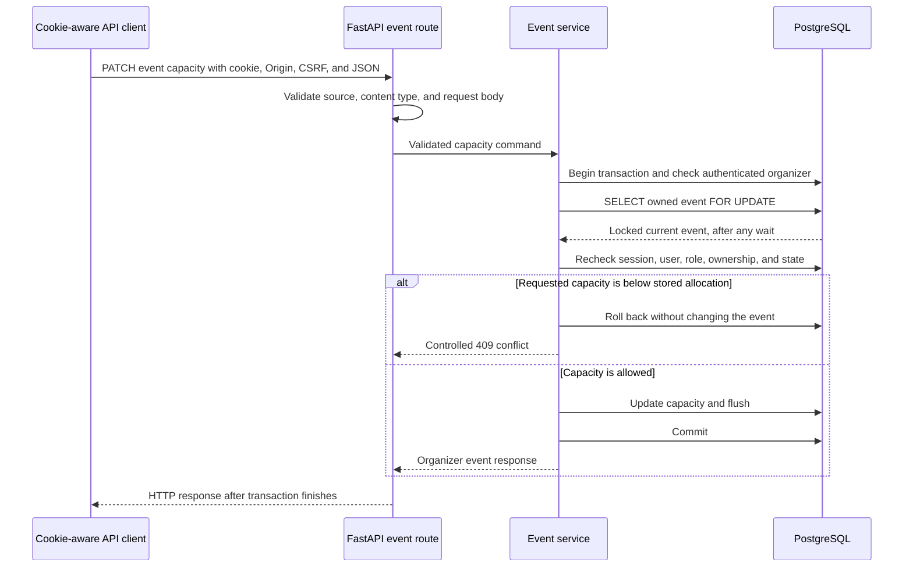

# Phase 3 explained: organizer event management

This guide describes the Phase 3 backend implementation prepared for review on top of
commit `9dc8f86f21546499dc10572c65938acff8df68a5`. It has not been committed or pushed.
The [validation report](../phase-3-validation.md) records actual verification results.
The [API contract](../contracts/api.md) contains the complete field and lifecycle rules.
The Phase 1 and Phase 2 explanations remain historical descriptions of those phases.

## 1. Phase overview

Phase 2 let the server identify users and distinguish attendees from organizers.
Phase 3 lets authorized organizers manage the events that people will eventually reserve.
It adds backend APIs, meaning HTTP endpoints another program can call. It does not add
event-management forms to React or implement seat booking.

For example, an organizer can now create a PostgreSQL workshop with ten seats, check its
draft, correct the room, publish it, change capacity, and close it. Other people can browse
the published event through the public API. Another organizer cannot edit the private draft.

## 2. What we implemented

### Draft creation with a server-assigned owner

An organizer supplies event details and receives a DRAFT event. The server obtains the owner
from the authenticated user, rather than accepting an organizer ID in JSON. New events start
with zero allocated seats. Attendees and anonymous clients cannot create events.

### Public and private reads

Public list/detail endpoints expose only PUBLISHED events. Drafts and CLOSED events return
404 from public detail, including when the requester happens to be their owner.
An organizer has a separate collection and single-event endpoint for their own events in
all three states. This avoids weakening public visibility just to read a draft.

### Metadata and capacity editing

Draft metadata and schedules can be edited. After publication, start time and booking
deadline cannot be supplied in metadata edits; title, description, location, and end time
remain editable if the merged schedule stays valid. CLOSED events are read-only.

Capacity has a separate endpoint. It must be a positive integer and cannot be reduced below
the stored allocated-seat count. Separating it from metadata makes the inventory-sensitive
operation explicit. There are still no API operations that allocate a seat.

### Forward-only event lifecycle

Only DRAFT can become PUBLISHED, and only PUBLISHED can become CLOSED. Repeating either
transition is rejected. There is no reopening, event cancellation, or deletion endpoint.
Closing changes event status; it does not cancel or release any reservation.

### Bounded pagination and error handling

Lists return a limited number of rows with a next-page cursor. Public and private responses
have different models so public results do not accidentally include allocated_seats.
Errors use the existing controlled error format or sanitized request-validation format.
Responses use Cache-Control: no-store, including organizer errors.

## 3. Technologies used

| Technology | Its role here |
| --- | --- |
| FastAPI | Registers public/organizer endpoints and validates HTTP inputs |
| Pydantic | Describes allowed fields and checks text, timestamps, capacities, and responses |
| SQLAlchemy | Reads models and manages explicit database transactions and row-lock queries |
| Psycopg | Carries SQL between Python and PostgreSQL |
| PostgreSQL | Persists events, enforces constraints, and orders conflicting writes with row locks |
| Alembic | Confirms the existing schema is current; Phase 3 needs no new revision |
| Pytest and TestClient | Check successful requests, rejections, rollback, and real database behavior |
| Docker Compose | Runs development services and a separate PostgreSQL test environment |
| React, TypeScript, Vite | Preserve the health screen and same-origin development API proxy |
| OpenAPI and YAML | Keep the checked-in machine-readable API description aligned with runtime |

Redis remains provisioned but unused. No Redis client, queue, expiration worker, or new
dependency was added. Existing Argon2 password hashing and database-backed sessions are reused.

## 4. How everything works



A **transaction** makes several database steps succeed or fail together. A **row lock** makes
another writer wait for the same event until that transaction ends. Locking is done in
PostgreSQL, so different API processes participate; a Python thread lock would not do that.

The service checks authentication before looking for the owned row. After a lock wait it
reads the session and user again: a session might have expired, been revoked, or lost its
role while waiting. It then uses the locked row's current state and allocation count.
No network cache call or password hashing happens while the event lock is held.

Publication uses PostgreSQL's current clock after the lock. Both start and booking deadline
must still be in the future. A valid draft can become stale as time passes, so validating
only the original create request would be insufficient.

For listing, the server sorts by starts_at and then UUID. UUID is the unique event identifier.
The second field breaks ties when workshops start at the same time. The cursor remembers
the last pair and listing scope. It is encoded navigation data, not a password or permission.
SQL still filters by publication state or authenticated owner on every page.

## 5. Important files and folders

Paths below are relative to the repository root.

| Path | Purpose |
| --- | --- |
| `backend/src/csrs/api/events.py` | Nine event operations, HTTP guards, role dependencies, response models |
| `backend/src/csrs/events/service.py` | Owned transactions, locks, lifecycle, visibility, and pagination queries |
| `backend/src/csrs/events/schemas.py` | Validated inputs, allowed patch fields, UTC timestamps, public/private responses |
| `backend/src/csrs/events/pagination.py` | Encodes/validates scoped keyset cursors |
| `backend/src/csrs/events/errors.py` | Controlled event errors without raw database details |
| `backend/src/csrs/main.py` | Registers event routers, controlled errors, and no-store responses |
| `backend/src/csrs/api/openapi.py` | Documents cookie/CSRF requirements without losing path/query parameters |
| `backend/src/csrs/auth/dependencies.py` | Existing current-user, organizer, and ownership guards reused here |
| `backend/src/csrs/auth/service.py` | Existing session/CSRF checks and database-clock helper reused here |
| `backend/src/csrs/models.py` | Existing event table and constraints; unchanged in Phase 3 |
| `backend/migrations/versions/0001_foundation_foundation_schema_and_sessions.py` | Existing schema revision; unchanged |
| `backend/tests/unit/test_event_inputs.py` | Input boundaries, cursor validation, and OpenAPI security checks |
| `backend/tests/integration/test_events.py` | Real PostgreSQL-backed API, visibility, lifecycle, and security tests |
| `backend/tests/integration/test_event_transactions.py` | Observed lock waits, stale-state rechecks, timeout, and rollback tests |
| `backend/tests/integration/conftest.py` | Existing disposable database fixtures plus login/event fixture helpers |
| `docs/contracts/api.openapi.yaml` | Generated complete implemented API contract |
| `docs/contracts/api.md` | Human-readable event rules and clarified contract decisions |
| `frontend/src/App.tsx` | Health screen; only its phase/scope text changed |

## 6. API endpoints

All paths start with `/api/v1`. Existing health/authentication endpoints continue to work.

| Method and path | What it does | Access |
| --- | --- | --- |
| GET /events | Paged published event summaries | Public |
| GET /events/{event_id} | Published event detail | Public |
| GET /organizer/events | Paged own events, including drafts/closed | Organizer |
| GET /organizer/events/{event_id} | Own full event plus allocated_seats | Owning organizer |
| POST /organizer/events | Create a draft; 201 response | Organizer + CSRF |
| PATCH /organizer/events/{event_id} | Edit permitted metadata; 200 | Owning organizer + CSRF |
| PATCH /organizer/events/{event_id}/capacity | Change capacity; 200 | Owning organizer + CSRF |
| POST /organizer/events/{event_id}/publish | Publish a draft; 200 | Owning organizer + CSRF |
| POST /organizer/events/{event_id}/close | Close a published event; 200 | Owning organizer + CSRF |

### Create an event

First log in as an organizer through the existing CSRF bootstrap/login flow. On the JSON
POST, send the authenticated cookie, current X-CSRF-Token, and the configured trusted Origin.
The example dates are illustrative; publication requires dates still in the future.

```json
{
  "title": "PostgreSQL workshop",
  "description": "Practice database transactions",
  "location": "Room 101",
  "starts_at": "2035-01-02T10:00:00Z",
  "ends_at": "2035-01-02T12:00:00Z",
  "booking_closes_at": "2035-01-02T09:00:00Z",
  "capacity": 10
}
```

The 201 response contains these details plus a generated id, organizer_id, status DRAFT,
and allocated_seats 0. The cookie and token are not returned in event response JSON.
You cannot supply owner, status, allocation count, or event ID in this request.

### Edit and change capacity

Send a metadata PATCH such as `{"title":"Advanced PostgreSQL","location":"Room 202"}`.
Send `{"capacity":15}` to the separate capacity endpoint. Publish and close use `{}`.
An empty metadata PATCH or a null value is rejected; an empty description is allowed.

### Read pages

`GET /api/v1/events?limit=20` returns `{"items":[...],"next_cursor":"..."}`.
Use that cursor on the next request, or stop when it is null. The maximum limit is 100.
Organizers use the private list for their own draft/closed events. Cursors cannot be moved
between public and organizer lists or between different organizers.

Public summaries contain id, title, location, starts_at, booking_closes_at, status, and capacity.
Public detail adds description, ends_at, and organizer_id. Organizer versions also expose
allocated_seats. No reservation rows or booking dashboard are returned.

### Error examples

Reducing capacity below the stored allocation returns 409:

```json
{
  "error": {
    "code": "CAPACITY_BELOW_ALLOCATED",
    "message": "Capacity cannot be below allocated seats."
  }
}
```

An unknown or another organizer's private event returns 404. Missing authentication returns
401; a wrong role or CSRF/source failure returns 403. Wrong JSON media type returns 415.
Invalid fields return sanitized 422 detail; an invalid combined schedule or cursor returns
a controlled 422 error envelope. Invalid lifecycle transitions return 409.

## 7. Database design

There is **no new table or migration in Phase 3**. The Phase 2 schema already includes users,
sessions, events, reservations, and idempotency_records. Alembic remains at 0001_foundation.

The events row holds its owner foreign key, details, schedule, lifecycle state, capacity,
allocation counter, ID, and timestamps. A foreign key means the owner must reference an
existing user. A database CHECK rejects nonpositive capacity, allocations outside zero to
capacity, or schedules that violate booking_closes_at <= starts_at < ends_at.

Every existing-event mutation locks the row, and SQLAlchemy flushes changes before the
transaction commits. Flush sends SQL to PostgreSQL; it is not an independent commit.
Validation after merging a PATCH can roll back every field in that edit together.
The service never changes organizer_id or allocated_seats through ordinary updates.

Reserved capacity is still only a stored counter foundation. A CHECK cannot enforce equality
with reservation rows in another table. Phase 3 does not create reservations or prove the
future no-overbooking invariant. Its capacity edit conservatively counts overdue stored holds
instead of implementing expiration early. Phase 4 must integrate due-hold cleanup under the
same event lock before capacity edits/admission.

## 8. Security and correctness

- Public registration still creates ATTENDEE, never a chosen organizer. Promotion uses the
  existing administrative command and requires a fresh login after session revocation.
- Mutation services validate the cookie, session-bound CSRF token, current active user, role,
  and stored ownership inside their transaction. Existing-event writes repeat those checks
  after obtaining the event lock. The HTTP layer also checks JSON and Origin/Referer.
- Public SQL queries always filter PUBLISHED; private queries filter owner. Another owner's
  event is unavailable as 404, rather than returning its draft information.
- Input models forbid extra fields and explicit null patches. Capacities must be JSON
  integers within PostgreSQL's integer range; booleans and numeric strings do not pass.
- Timestamps require explicit timezones and normalize to UTC. Server-side publication uses
  PostgreSQL time, including after a lock wait. Naive or epoch-form input is rejected.
- No-store responses, redacted validation errors, and controlled database failures preserve
  the existing security boundary. A lock/statement timeout rolls back and returns a safe 503.

For example, if another transaction increases allocation while a capacity edit waits, the
edit reads the newly committed allocation after obtaining the lock. It cannot approve a
reduction using the old number. Real PostgreSQL tests exercise that situation with seeded
reservation data; that is not a finished booking service or final-seat race benchmark.

## 9. Testing and verification

The [Phase 3 validation report](../phase-3-validation.md) is the source for final commands,
counts, and exit statuses. It distinguishes the final complete run from earlier development
attempts. Existing Phase 1/2 validation reports remain unchanged historical evidence.

The final complete container run passed **323 tests in 26.81 seconds, exit 0, with no skips
or failures**: 107 unit/contract cases and 216 real PostgreSQL integration cases. This includes
the earlier 170 cases; Phase 3 adds 153 cases. That duration is test execution time, not an
application performance benchmark. All 31 expected live HTTP smoke checks also passed.

Unit tests exercise input boundaries, timestamp normalization, scoped cursor parsing, and
generated OpenAPI security. Integration tests run against real PostgreSQL in generated,
disposable databases on the dedicated test service. They do not truncate development data.

The tests cover create/read/edit/publish/close, private visibility, role restrictions, all
mutation CSRF boundaries, partial-update rollback, stored-allocation capacity bounds, and
pagination ties. Transaction tests hold a real event lock and observe PostgreSQL's blocking
state before allowing the waiting request to proceed. They also test expiration/revocation/
role changes during waits, safe statement timeout, and injected failure after SQL flush.

Passing tests are evidence for those specific behaviors. They do not establish booking
throughput, worker recovery, or an implemented reservation-capacity guarantee. Frontend build,
Compose checks, schema checks, and live HTTP smoke results are recorded separately.

## 10. What was NOT implemented yet

- Reservation creation, holds, confirmation/cancellation, or booking history.
- Reservation idempotency claims/replays or request-time hold cleanup.
- Expiration worker, Redis rate limiting/caching, or scheduled maintenance.
- Public availability and organizer reservation dashboard endpoints.
- Full event/account/booking forms in React, payments, or deployment.

Published does not mean bookable: a full or past event remains public until explicitly closed.
Draft schedules may become stale and must be repaired before publication. Pages are not a
frozen snapshot if events are edited between requests. Event commands have no idempotency
replay contract, so clients must not assume retrying creation cannot make a second event.

## 11. Interview preparation

### Why separate organizer detail from public detail?

The public route has one simple rule: only PUBLISHED. The owner-only route permits drafts
without introducing cookie-dependent public responses or building a dashboard too early.

### Why lock metadata edits as well as capacity changes?

An edit can race with publication or closing. Locking and rereading state ensures the edit
uses the lifecycle rules that apply after any competing transaction finishes.

### Why check the session twice?

A request might wait on an event lock. Its session could expire or its role could change
while it waits. The second check prevents a stale earlier authorization from allowing a write.

### Does READ COMMITTED alone prevent overbooking?

No. It controls which committed data a statement sees. The explicit shared event lock and
future atomic reservation/counter updates are also required. Booking remains unimplemented.

### Why allow a past schedule in a draft?

A saved draft can become stale naturally. Keeping it editable lets the organizer repair it.
Publication is the gate that requires a future start and booking deadline using database time.

### Why use a separate capacity endpoint?

It makes an inventory-sensitive change explicit and provides a clear place for the future
shared expiration logic. Owner, status, and allocation count are never ordinary patch fields.

### What if the event already has overdue holds?

Phase 3 compares against the stored count, so it can refuse a reduction conservatively.
It never releases seats itself. Phase 4 must add due-hold transitions under the same lock.

### Why keyset pagination rather than offset?

It asks for rows after the last time/ID pair, avoids a growing skipped-row offset, and handles
equal start times deterministically. It still cannot freeze a collection across later edits.

### Does closing cancel everyone's booking?

No. It changes event state only. The later reservation service must stop new holds while
respecting valid existing holds and the separate confirmation/cancellation rules.

### Why are migration files unchanged?

Phase 2 already created the event table and its constraints/indexes. Phase 3 uses that schema.
Adding an empty or duplicate migration would not improve safety; schema parity is verified.

## 12. Phase summary

Phase 3 added backend APIs for organizers to manage their own events.
Public clients can browse published events while private drafts remain protected.
The event lifecycle moves from DRAFT to PUBLISHED to CLOSED.
PostgreSQL row locks protect edits and state checks across concurrent writers.
The implementation reuses session, role, ownership, and CSRF protections from Phase 2.
Reservation operations, expiration, Redis integration, and event screens remain deferred.
