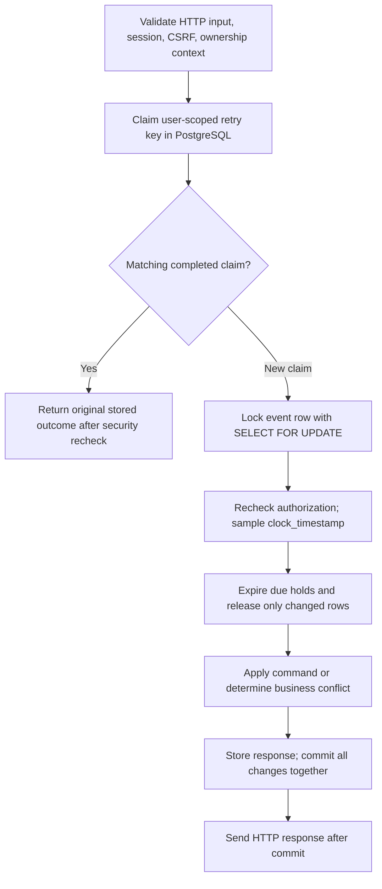

# Phase 4 explained: reservations that stay correct under concurrency

This guide describes the Phase 4 implementation awaiting review. No Phase 4 commit or push
has been authorized. Read the [Phase 3 explanation](phase-3-explanation.md) for event management
and the [validation report](../phase-4-validation.md) for commands and actual results.

## 1. Phase overview

Phase 3 let organizers publish workshops. Phase 4 lets people hold, confirm, and cancel seats.
The important problem is **concurrency**: several requests can execute at overlapping times.

Imagine one workshop seat remains. Alice and Bob both read "one seat available." If each
creates a reservation from that old observation, two people receive the same final seat.
That is a **race condition**: correctness depends on how operations overlap.

Phase 4 makes PostgreSQL order changes to each event. A request must obtain that event's row
lock before deciding whether a seat exists. It also handles retries, expired holds, and errors.

## 2. What we implemented

- One-seat HELD reservations, normally valid for five minutes, capped by booking close.
- Confirmation, cancellation, and request-time expiration with one shared capacity protocol.
- Durable idempotency for all three commands, including stored business conflicts.
- Owner-only reservation detail/history and public advisory availability.
- Session/CSRF/source validation and ownership checks, including checks after lock waits.
- PostgreSQL race and failure tests, including two independent API processes.

An **invariant** is a rule that must always remain true. Here, at every committed state:

```text
allocated_seats = count(persisted HELD rows) + count(CONFIRMED rows)
0 <= allocated_seats <= capacity
```

An overdue HELD row still counts in the stored counter until a transaction expires it.
The display can already show effective EXPIRED. Stored bookkeeping and effective validity
answer different questions.

## 3. Technologies used

| Technology | Job in this phase |
| --- | --- |
| FastAPI and Pydantic | Validate paths, empty JSON bodies, retry keys, and response fields |
| SQLAlchemy | Own independent database sessions and explicit transaction scopes |
| Psycopg | Carry SQL between Python and PostgreSQL |
| PostgreSQL 17 | Row locks, unique claims, durable commits, database time, constraints |
| Pytest | Check business behavior, controlled races, and injected failures |
| Uvicorn | Run two separate API processes in the cross-process HTTP tests |
| Docker Compose | Run the real database, backend, proxy, and isolated test service |

No Redis client, broker, new dependency, or migration was added. A SQLAlchemy Session is
a unit of database work; it is different from a security session used to recognize a login.

## 4. How everything works

A **transaction** groups changes so they commit together or roll back together. **Commit**
makes them durable and visible to other transactions. **Rollback** discards the transaction's
changes. **Flush** sends pending SQL but does not commit it.

An accepted hold changes three things in one transaction: a reservation row, the event's
counter, and the completed idempotency response. A crash before commit cannot leave one
of those pieces committed alone.



**Row-level locking:** `SELECT ... FOR UPDATE` tells PostgreSQL that this transaction controls
changes to the selected event until it finishes. A competing command for that event waits.
After Alice commits the last seat, Bob obtains the lock, reads the updated counter, and gets
EVENT_FULL. A different event has a different lock. A Python mutex would only coordinate one
process, whereas the database lock also works between separate API processes.

**READ COMMITTED:** each SQL statement sees committed database data when that statement
begins. This isolation level alone does not prevent the last-seat race; the explicit event
lock orders all capacity-changing decisions. Lock order is key claim, event, reservation rows.
Confirm/cancel first discover the reservation's immutable event ID without a reservation lock.

**Time:** a request can wait for a lock. PostgreSQL `now()` means transaction-start time and
could be stale after that wait. `clock_timestamp()` gives actual current database time. The
service samples it after the event lock and uses one decision instant for the whole command.
At exactly the hold deadline, the hold is expired. A confirmation accepted one microsecond
before that deadline can commit later because its confirmed_at records the accepted instant.

**Expiration:** cleanup updates only this event's due HELD rows and uses RETURNING to count
the rows actually changed. It subtracts that count from allocated_seats. Repeating cleanup
cannot release an already EXPIRED row again. Capacity edits use this helper too.

**Idempotency:** a client chooses an Idempotency-Key for an intentional command. The server
hashes POST, canonical path, and validated `{}` into a fingerprint. A PostgreSQL unique
constraint on `(user_id,key)` chooses one claim winner. Concurrent matching requests wait
and then replay its original status/body. A different path with that key returns a conflict.
Invalid extra body fields fail validation before claiming a key.

For example, Alice's hold commits, but Wi-Fi drops the response. Retrying the same key returns
the same reservation ID; it does not allocate another seat. If confirmation happened afterward,
the old hold replay can still say HELD. Alice fetches current detail to see CONFIRMED.

Business conflicts are stored too. A key that returned EVENT_FULL keeps replaying that result
even after another attendee cancels. A new intentional attempt needs a new key. A lost
connection during COMMIT leaves the outcome uncertain; retry the same key to discover it.
The server does not automatically invent a key or blindly rerun uncertain work.

## 5. Important files and folders

Paths below are relative to the repository root.

| Path | Purpose |
| --- | --- |
| `backend/src/csrs/reservations/service.py` | Claim, replay, lock, decision, transitions, reads |
| `backend/src/csrs/reservations/transitions.py` | Shared due-hold cleanup; never commits |
| `backend/src/csrs/reservations/schemas.py` | Reservation/page/availability response shapes |
| `backend/src/csrs/api/reservations.py` | Six routes, key validation, replay response headers |
| `backend/src/csrs/events/service.py` | Capacity edits integrate locked cleanup |
| `backend/src/csrs/auth/` | Existing sessions, CSRF, attendee and ownership guards |
| `backend/tests/integration/test_reservations.py` | HTTP behavior and state/time boundaries |
| `backend/tests/integration/test_reservation_transactions.py` | Process races, lock waits, faults |
| `backend/scripts/smoke_reservations.py` | Reproducible live proxy checks and scoped cleanup |

## 6. API endpoints

All paths below start with `/api/v1`. Commands accept `{}` and require cookie, trusted Origin,
X-CSRF-Token, and one Idempotency-Key header. Keys contain 1-128 visible ASCII characters
without spaces. Confirmation/cancellation require ownership of the stored reservation.

| Method/path | Result |
| --- | --- |
| POST `/events/{event_id}/holds` | 201 reservation |
| POST `/reservations/{reservation_id}/confirm` | 200 reservation or documented conflict |
| POST `/reservations/{reservation_id}/cancel` | 200 reservation or documented conflict |
| GET `/reservations/{reservation_id}` | Owner-only effective state |
| GET `/me/reservations` | Private items/next_cursor, default 20, maximum 100 |
| GET `/events/{event_id}/availability` | Public PUBLISHED-event advisory capacity snapshot |

Reservation output contains id, event_id, status, created_at, hold_expires_at, confirmed_at,
cancelled_at, expired_at, and server_time. Timestamps normalize to UTC. It does not expose
another attendee's identity. All these responses use no-store.

New executions send `Idempotency-Replayed: false`; replay sends true. Errors use the established
error/code/message envelope. Invalid fields use sanitized 422 detail. Missing authentication
is 401, CSRF is 403, missing/foreign private resources are 404, business conflicts are 409,
wrong media type is 415, and transient database failure/timeout is 503.

## 7. Database design

The existing five tables were sufficient. Alembic remains at `0001_foundation`. A reservation
represents one seat. The event owns capacity and allocated_seats; reservations reference
their immutable user and event. The partial unique index allows one HELD/CONFIRMED row per
user/event. CANCELLED/EXPIRED rows remain history, allowing a new reservation later.

| Starting state and command | Result | Allocation change |
| --- | --- | --- |
| New admitted hold | HELD | +1 |
| HELD confirmed strictly before deadline | CONFIRMED | 0 |
| HELD confirmed at/after deadline | EXPIRED and 409 HOLD_EXPIRED | -1 |
| HELD cancelled before deadline | CANCELLED | -1 |
| HELD cancelled at/after deadline | EXPIRED and 200 | -1 |
| CONFIRMED confirmed again | CONFIRMED and 200 | 0 |
| CONFIRMED cancelled before event start | CANCELLED | -1 |
| CONFIRMED cancelled at/after start | Unchanged and 409 CANCELLATION_CLOSED | 0 |
| CANCELLED/EXPIRED cancelled again | Unchanged and 200 | 0 |
| CANCELLED confirmed | 409 INVALID_RESERVATION_STATE | 0 |
| EXPIRED confirmed | 409 HOLD_EXPIRED | 0 |

Confirmed reservations do not expire. Closing an event stops admission but preserves valid
existing holds. Rebooking creates a new row and uses a new key. Idempotency outcomes are JSONB
objects retained in the database; no key-retention cleanup policy is implemented.

## 8. Security and correctness

The service derives the user from the existing database-backed session, never from the body.
Organizers may attend events too. It checks CSRF and active session/user state inside the
transaction and rechecks after key/event waits. Ownership also applies before replay.
Security failures roll back a new claim instead of storing a completed booking response.

No success is sent before commit. A business conflict can still commit useful expiration:
confirming an overdue hold releases its seat and stores HOLD_EXPIRED. Raising an exception
inside that transaction would accidentally undo the release. Capacity reduction similarly
retains useful cleanup even if the requested capacity is still too low.

GETs never change reservation rows. Availability counts CONFIRMED plus valid HELD rows in one
SQL statement with one time sample. It is a snapshot, so a later hold still needs locked
admission. Database CHECKs bound the counter; the service preserves equality with counted rows.
Arbitrary administrator SQL bypassing the protocol is outside that guarantee.

## 9. Testing and verification

The final suite has **417 passing tests**: 114 unit/contract and 303 PostgreSQL integration
tests. It retains Phase 1-3 behavior, updating assertions where reservation routes and capacity
cleanup intentionally change the old scope. See the validation report for the actual duration.

The two-process tests start separate Uvicorn applications and database pools. Barriers release
50 or 100 HTTP attempts together. Capacity 1 admits exactly one; capacity 20 admits exactly 20.
Ten concurrent duplicate-key requests allocate once and replay; different keys for the same
user still cannot create multiple active rows.

Controlled tests observe `pg_blocking_pids` to verify real lock waits, and run both orderings
of confirmation/cancellation, expiry/transition, organizer/admission, and close/confirmation.
Exact boundary tests control the decision clock while still executing real PostgreSQL changes.
Those boundary tests are distinct from lock tests using PostgreSQL's real current clock.

Fault tests inject failures after row/counter/outcome writes and before commit. All pieces,
including cleanup, roll back. Other injections model both committed and uncommitted outcomes
of a lost commit acknowledgement, then recover with the same key. A separate HTTP test drops
the response after commit. These are controlled fault simulations, not a physical network cut.

Ruff, migration drift checks, frontend TypeScript/build, OpenAPI equality, Compose, and 33 live
HTTP smoke checks also pass. This is correctness evidence for those cases, not a production
throughput or latency benchmark. No hosted CI run exists for this uncommitted change.

## 10. What was NOT implemented yet

Phase 5 adds the standalone expiration sweeper. Until then, quiet events can retain overdue
HELD rows until a relevant request arrives; effective reads already show them as expired.
Phase 6 adds Redis limiting/caching. Phase 7 adds business screens and organizer dashboard.
Phase 8 adds deployment, backup/restore, and broader load reporting. Payments, quantities,
seat maps, account recovery, and reservation-wide event cancellation are also absent.

## 11. Interview preparation

**Why use one event lock?** It gives every capacity writer one understandable ordering point
across processes. The cost is serialized writes for a hot event; measure before redesigning.

**Why not just check capacity first?** Another transaction can allocate between that check and
the write. The decision must happen while the shared lock is held.

**Why store a counter and count rows in tests?** The counter makes admission inexpensive.
Independent row counts detect mistakes that the counter's CHECK constraint cannot detect.

**Why is idempotency different from active-user uniqueness?** Idempotency preserves one
request's original outcome. Active uniqueness prevents multiple active bookings even when
one user submits different intentional keys. Both are needed.

**What if a request times out?** A lock/statement timeout rolls back and returns 503. Connection
loss during commit is ambiguous. The client retains its key and retries; committed work replays,
while a rolled-back claim can execute. The server performs no automatic retry loop.

**What prevents double release?** Only HELD or CONFIRMED transitions release capacity. Expiration
updates only due HELD rows and subtracts the number actually changed. Terminal repeats do nothing.

**Why can a closed event confirm?** Closing stops new holds. The contract preserves valid
existing promises, whose deadline is already capped by booking close.

**Would SQLite tests be enough?** They cannot establish this PostgreSQL locking behavior.
These tests use actual PostgreSQL transactions, connections, and independent API processes.

## 12. Phase summary

Phase 4 lets an authenticated attendee hold one seat, confirm it, or cancel it.
Every capacity decision uses the event's PostgreSQL row lock.
The reservation row, counter, and retry outcome commit together.
Expired holds are reclaimed during requests, and exact deadline equality means expired.
Retrying the same key recovers the original response without allocating again.
Real PostgreSQL tests cover contention, ownership, boundaries, and failures.
The worker, Redis integration, business UI, and deployment remain future phases.
