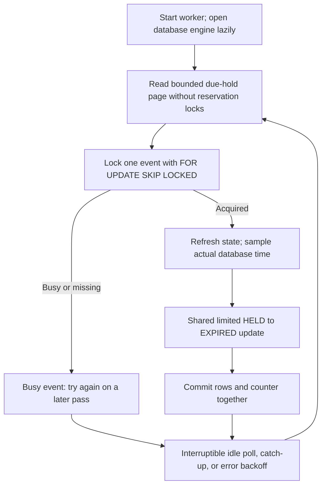

# Phase 5 explained: automatic expiration and safe recovery

This describes the local Phase 5 implementation awaiting external review. No Phase 5 commit
or push is authorized. Read [Phase 4](phase-4-explanation.md) for reservation commands and
[Phase 5 validation](../phase-5-validation.md) for actual verification evidence and limitations.

## 1. Phase overview

A hold temporarily allocates a seat. Phase 4 already rejected late confirmations and reclaimed
expired holds when a relevant request arrived. But a workshop with no incoming requests could
retain overdue HELD rows indefinitely. A separate worker now cleans those quiet events.

The worker is an independent Python process. PostgreSQL stores the work: a HELD row whose
deadline has passed. The process can stop, crash, or restart without losing that obligation.

## 2. What we implemented

- An independently runnable expiration worker with an opt-in Docker Compose service.
- Bounded discovery pages and bounded row changes within each event transaction.
- Event-first locking and the same expiration transition used by the API.
- Graceful signals, JSON logs, recoverable database errors, and bounded retry delays.
- Real PostgreSQL tests for duplicate workers, API races, crashes, restart, and outages.
- One partial index for efficient ordered cleanup inside a large event.

The API still exposes the same paths and response shapes. Redis, business UI, and deployment
remain later phases. The project handoff remains the approved Phase 4 snapshot until review.

## 3. Technologies used

| Technology | Purpose |
| --- | --- |
| Python process and signals | Independent startup; SIGTERM/SIGINT request graceful shutdown |
| SQLAlchemy and Psycopg | Independent sessions, explicit transactions, bounded database access |
| PostgreSQL 17 | Durable work discovery, event locks, actual time, constraints, atomic commits |
| Alembic | Add the ordered per-event expiration index explicitly |
| Docker Compose | Run API and worker independently using the same backend build conventions |
| Pytest and subprocesses | Exercise actual database races, worker processes, and recovery |

No broker, Celery, distributed lock, Redis client, or new package dependency was introduced.

## 4. How everything works

Imagine a librarian processing overdue loans in small groups. First they find candidates.
Before changing a particular loan, they check its current state because another person may
already have returned it. The worker similarly separates candidate discovery from decisions.



**Discovery:** read at most the configured number of due reservation entries ordered by
(hold_expires_at,event_id). Deduplicate the event IDs in that small page. These reads take
no reservation row locks. A candidate is a suggestion, not permission to release capacity.

**Batching:** a batch is a limited group of work. The same size setting caps scanned entries
and row transitions per event transaction. One page can contain several events, each committed
separately. A single event with thousands of overdue holds is drained in chunks rather than
one enormous worker transaction. The API retains its existing cleanup behavior.

**Navigation:** a keyset position remembers the last deadline/event pair in a pass. The pass
also has a fixed cutoff, so newly due holds cannot keep extending its end forever. Busy groups
can be passed, allowing later events to progress. When the pass ends, discovery wraps to the
oldest remaining work. Equal-deadline duplicates from one event may be passed together because
their event is already a candidate; later passes handle remaining chunks.

**Pacing:** after a successful expiration, the next scan waits at most 0.25 seconds. If a
productive pass reaches its end, it wraps after the same short delay so equal-deadline rows
can receive another bounded chunk. A full page of busy or stale candidates advances after at
most one second, allowing later events to be considered without a tight loop. An empty or
unproductive completed pass waits for the configured normal poll interval. Database failures
keep their separate capped backoff.

That position is only navigation. It is not a durable queue or proof that work completed.
Restarting discards it and begins from the oldest database rows, which is safe.

**Event locking:** SELECT FOR UPDATE SKIP LOCKED obtains the event row if available. If the API
or another worker owns it, this attempt defers the event. The worker never locks a reservation
before its event. Once the event lock is held, it samples clock_timestamp and uses the shared
conditional transition. Equality at the hold deadline means expired.

**Double release:** UPDATE changes only due HELD rows and returns the IDs actually changed.
The worker subtracts exactly that count. A later worker finds EXPIRED rows and subtracts zero.
Confirmed and cancelled rows are never expiration candidates. The event lock serializes
capacity-changing decisions between the API and all workers.

**Crash before commit:** PostgreSQL rolls back the changed rows and counter together. A new
worker finds the still-HELD rows. **Interruption after commit:** rows are already EXPIRED, so
rediscovery or duplicate processing cannot decrement again. No process-local list owns a seat.

**Database failure:** connection, operational, and pool timeout errors end the failed
transaction. The worker logs sanitized information and waits before retrying. Discovery
failures use capped exponential backoff: the delay increases up to its configured maximum.
Failures within a cached page are paced too, and later candidates can still be attempted.
Waiting uses an interruptible event rather than a busy loop.

## 5. Important files and folders

Paths below are relative to the repository root.

| Path | Purpose |
| --- | --- |
| `backend/src/csrs/worker.py` | CLI, discovery, event transactions, lifecycle, logs, retries |
| `backend/src/csrs/reservations/transitions.py` | Shared expiration with optional row limit |
| `backend/src/csrs/config.py` | Poll, batch, and backoff settings with bounds |
| `backend/src/csrs/models.py` | Existing schema plus the new partial index declaration |
| `backend/migrations/versions/0002_worker_expiry_bounded_event_cleanup.py` | Explicit index migration |
| `backend/tests/integration/test_worker.py` | PostgreSQL boundaries, batching, rollback, API races |
| `backend/tests/integration/test_worker_processes.py` | CLI workers, signals, real process crashes/outages |
| `backend/scripts/smoke_worker.py` | Generated local backlog and live worker/API verification |
| `compose.yaml` | Separate opt-in worker service |

## 6. API endpoints

No endpoint was added or changed in Phase 5. Existing reservation commands still authenticate
users, require CSRF and idempotency keys, and check ownership. The worker is an internal
maintenance process with no HTTP listener or user credentials. API/OpenAPI version stays 0.4.0.

To run locally, first migrate the database, then start the worker profile:

```powershell
docker compose exec -T backend python -m alembic upgrade head
docker compose --profile worker up --build -d worker
docker compose --profile worker logs --tail 20 worker
docker compose --profile worker stop worker
```

Host entry point with explicit .env loading:

```powershell
.\.venv\Scripts\python.exe -m csrs.worker --env-file .env
```

The default idle polling delay is 15 seconds. Batch size defaults to 100. Catch-up and
scan-ahead delays are fixed upper caps of 0.25 and one second, respectively, also limited by
the configured poll interval. Initial retry delay is one second, capped at 30 seconds.
README and validation list bounds and exact setting names.
Compose restarts the worker unless stopped. Normal startup does not run migrations.

## 7. Database design

There are still five application tables. The latest Alembic revision is 0002_worker_expiry.
It adds the partial index `(event_id,hold_expires_at,id) WHERE status='HELD'` for ordered,
limited cleanup after locking one event. The existing `(hold_expires_at,event_id)` partial
index supports global discovery. A partial index contains only rows matching its predicate.

No column, state, counter, or foreign key changed. The worker maintains:

```text
allocated_seats = count(persisted HELD + CONFIRMED)
0 <= allocated_seats <= capacity
one persisted active reservation per user/event
```

An overdue HELD row still counts until its expiration transaction commits. GET can already
show effective EXPIRED without writing. Existing idempotency records belong to user requests;
the worker does not modify or manufacture them.

## 8. Security and correctness

The worker uses the configured PostgreSQL connection, not a public maintenance API. Its JSON
logs contain event name, timestamp, process ID, counters, and sanitized error type/SQLSTATE.
SQL text, connection URLs, session cookies, and CSRF tokens are excluded.

All capacity writers use the same event lock. The worker locks one event per transaction,
refreshes its state, and uses actual post-lock time. It never holds reservation locks during
discovery. CLOSED events remain eligible for cleanup because closing preserves existing holds.
Valid confirmations that won before expiration remain CONFIRMED forever unless cancelled.

SIGTERM/SIGINT request stop. Idle/backoff waits wake promptly; an active event transaction
finishes before clean exit. A forced kill instead rolls back uncommitted changes. Unexpected
programming/schema errors fail visibly rather than being silently treated as recoverable.

## 9. Testing and verification

The final backend suite passes 474 cases: 130 unit/contract and 344 real PostgreSQL integration
tests, retaining the earlier 417-case behavior. Independent sessions and observed lock waits
exercise both API-first and worker-first orderings. Worker SKIP LOCKED is tested as an immediate
deferral; API waiters are observed when the worker owns the event.

Two independent worker processes are gated after reading identical candidate pages, then
released. Another process test holds the event row in one worker and proves the second reports
SKIP LOCKED deferral before release. Only the actual HELD transitions release seats.
Real worker processes are killed
before commit and interrupted after commit, then restarted. Signal tests cover idle and
active-transaction shutdown. Outage tests temporarily deny connections to only the generated
test database and terminate its connections, then restore access and observe recovery.

Other tests cover exact deadline equality, confirmed/terminal rows, repeated sweeps, bounded
large-event cleanup, prompt productive catch-up, forward progress past a busy oldest event,
fixed pass cutoffs, migration
upgrade/downgrade, index eligibility, and consistent SQL reconciliation. No SQLite or mocked
lock is used as concurrency evidence. Clock-boundary overrides are distinct from real-clock
post-lock tests. Validation records local smoke/build checks and preliminary failures honestly.

## 10. What was NOT implemented yet

Phase 6 Redis limits/cache, Phase 7 dashboard/business UI, and Phase 8 production deployment,
backup/restore, and broad load reporting remain deferred. This worker is not a message broker,
notification scheduler, or a production performance guarantee. Idempotency retention cleanup,
payments, quantities, and seat maps remain absent.

## 11. Interview preparation

**Why is request-time expiry insufficient?** Without requests, stored HELD rows and their
counter units can remain overdue. The worker persists cleanup without changing request-time safety.

**Why not lock reservations with SKIP LOCKED first?** The API already locks events first.
Reversing that order could create avoidable deadlocks. Workers coordinate on the event row too.

**Why can two workers see the same candidate?** Discovery is advisory. The event lock plus
conditional HELD transition determines who actually changes state; duplicate discovery is harmless.

**Why no durable cursor?** PostgreSQL already stores every unfinished hold. Losing a navigation
position repeats discovery, which is safe. A durable queue would add unnecessary recovery state.

**What if one event is busy?** Skip it, advance through the bounded pass, and revisit it after
wrapping. Other events can progress. Eventual cleanup still needs database access and an
opportunity to obtain the event lock; there is no fixed cleanup-latency promise.

**Why add an index?** Bounded writes alone do not ensure cheap selection. The event-first
ordered partial index lets PostgreSQL find a small due subset without sorting a huge event.

**What if commit acknowledgement is lost?** Rediscover and conditionally expire again.
Committed EXPIRED rows do nothing; uncommitted changes roll back and HELD rows remain discoverable.

## 12. Phase summary

Phase 5 persists expiration even when no API request arrives.
The worker reads small candidate pages from PostgreSQL.
Each expiration transaction locks one event before touching reservations.
Only rows actually changed from HELD to EXPIRED release seats.
Crashes and restarts recover from durable database state.
Multiple workers follow the same protocol and safely defer busy events.
The implementation remains uncommitted until external review approves publication.
