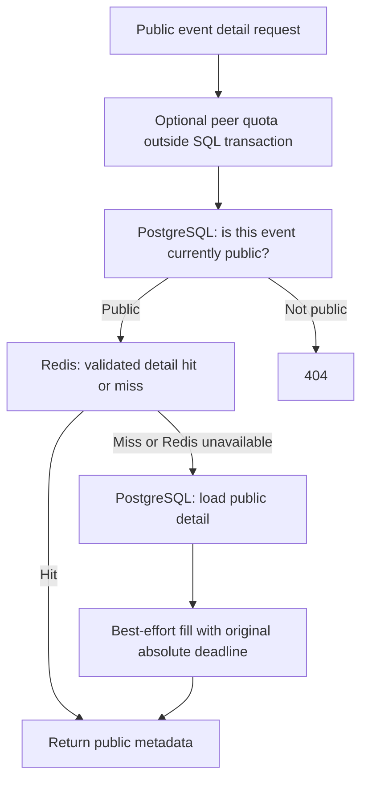

# Phase 6 explained: Redis support without changing reservation authority

This describes local Phase 6 work awaiting external review. Nothing is committed or pushed.
The [validation report](../phase-6-validation.md) records actual results and limitations.
The project handoff remains the approved Phase 5 snapshot.

## 1. Phase overview

Redis is a server that keeps small values in memory and can automatically remove them after
a deadline. CSRS uses it for request quotas and temporary copies of public event details.
PostgreSQL remains the durable database that decides whether a seat can be allocated.

Imagine a library with an official lending ledger and a noticeboard. The noticeboard can
help visitors browse, but the librarian checks the ledger before lending the last copy.
Losing the noticeboard does not change who has borrowed a book.

## 2. What we implemented

- One pooled Redis client per API process, created without connecting during startup.
- Atomic quotas shared across API processes, with deliberate outage policies.
- A short-lived cache for public event detail, with current SQL publication checks.
- Post-commit invalidation and absolute expiration that bounds delayed stale fills.
- Bounded DNS/TCP/socket waits, safe fallback, resource cleanup, and sanitized JSON logs.
- Real Redis/PostgreSQL tests, independent API processes, and live stop/restart verification.

Availability, reservations, sessions, CSRF tokens, private organizer data, and durable retry
outcomes are never cached. There is no Redis seat counter or reservation lock.

## 3. Technologies used

| Technology | Purpose |
| --- | --- |
| Redis 7.4 | Ephemeral quotas and public detail values with expiry |
| redis-py 8.1 | Synchronous connections, protocol, pooling, authentication, and optional TLS |
| Lua scripts | Keep each quota check/increment/expiry atomic; give cache fills absolute expiry |
| FastAPI route adapters | Apply support operations outside business transactions |
| PostgreSQL and SQLAlchemy | Keep all existing authorization, locks, states, and atomic commits |
| Pytest, separate processes, Compose | Exercise actual Redis/SQL behavior and recovery |

No caching framework, message broker, database migration, or frontend feature was introduced.

## 4. How everything works

**Rate limiting** means accepting only a configured number of requests for an identity during
a time window. The default window lasts 60 seconds from its first accepted request. One Redis
script reads the counter, checks the quota, increments an allowed request, and sets expiry.
Other processes cannot interleave those steps and each believe a request is still allowed.
Rejected requests do not extend the window. A 429 response tells the caller how many seconds
to wait through Retry-After.

**Caching** means storing a temporary copy of data that can be regenerated from PostgreSQL.
A **hit** finds a valid cached detail; a **miss** loads SQL detail and tries to store a copy.
**TTL**, or time to live, is how long that copy may remain. The default is 15 seconds.
Each hit first queries SQL for current PUBLISHED visibility, so Redis cannot expose a closed
event or private draft. List pages and availability always use their existing SQL reads.



After an event edit, capacity edit, publish, or close commits, its route deletes the cache key.
Deleting before commit would allow readers to reload the old committed version while the
change was still pending. Redis invalidation never holds the PostgreSQL event lock.

An older read can still finish after a later invalidation. CSRS accepts bounded stale public
metadata: its fill expires at the Redis time sampled before that SQL read plus TTL. A late fill
cannot start a new full TTL, and an already expired fill is skipped. Hits never renew expiry.
Displayed metadata capacity can therefore be stale; SQL availability and hold admission stay
independent. PostgreSQL checks the real capacity under its event lock before creating a hold.

## 5. Important files and folders

| Path | Purpose |
| --- | --- |
| backend/src/csrs/redis_support.py | Pool, quota/cache scripts, payload validation, failure policy, logs |
| backend/src/csrs/redis_connection.py | Bounded shared DNS lookup and TCP adapter; inherited TLS checking |
| backend/src/csrs/api/redis_dependencies.py | Peer identity and authenticated mutation preflight |
| backend/src/csrs/api/events.py | Cache public detail and invalidate only after service commit |
| backend/src/csrs/api/auth.py | Limit new sessions/login/register; retrieve existing token during outage |
| backend/src/csrs/api/reservations.py | Apply user quota before the unchanged command transaction |
| backend/tests/unit/test_redis_runtime.py | Deterministic configuration/DNS/failure/cleanup tests |
| backend/tests/integration/test_redis_support.py | Actual Redis/PostgreSQL and independent process tests |
| backend/scripts/smoke_redis.py | Scoped live available/outage/recovered API and worker checks |
| compose.yaml, .github/workflows/ci.yml | Dedicated test Redis and live outage/recovery automation |

## 6. API endpoints and running the system

No path or response body shape was added. OpenAPI documents 429 and public metadata staleness.
API version remains 0.4.0. Defaults are:

| Operations | Shared quota | Redis unavailable |
| --- | --- | --- |
| New anonymous session creation | 30/peer/window | 503, no new row |
| Register/login combined | 10/peer/window | 503 |
| Public event list/detail/availability | 120/peer/window | Use PostgreSQL |
| Booking commands/replays and organizer mutations | 60/user/window | Use PostgreSQL |

Existing valid token retrieval, logout, health, and private reads are unthrottled. A mutation
quota validates session/CSRF/role before Redis; the original SQL service then checks again,
including after waits. Quotas do not replace ownership or authorization.

```powershell
docker compose up --build -d --wait --wait-timeout 120
docker compose exec -T backend python -m alembic upgrade head
docker compose --profile worker up --build -d worker
docker compose --profile test run --build --rm backend-test
```

[README](../../README.md#redis-support-phase-6-awaiting-review) lists every setting and the
three live smoke commands. Never overwrite an existing .env or delete development volumes.

## 7. Database design

No PostgreSQL table, column, index, or migration changes. Alembic head is still
0002_worker_expiry. SQL maintains allocation equality, capacity bounds, active-user uniqueness,
and durable idempotency exactly as before.

Redis keys use namespace/environment/version prefixes. Example event key:
`csrs:local:v1:event:UUID`. Its value is version 1 plus the existing public detail fields.
Quota keys add scope and SHA-256(identity); raw cookies, emails, and passwords are absent.
Digesting an IP does not make it anonymous.

The local Redis memory budget is 64 MiB with noeviction and no persistence. Short key lifetimes
and 64 KiB cache values bound use. A restart discards these supporting values. If memory fills,
operations use the same documented outage policies instead of silently evicting quota counters.

## 8. Security and correctness

Redis never supplies state to a reservation transaction. READ COMMITTED, the event-first row
lock, refreshed state, post-lock clock_timestamp, shared expiration, and atomic row/counter/
idempotency commits remain intact. The worker never opens a Redis client. Its SKIP LOCKED
deferral and restart recovery remain PostgreSQL-backed.

Current server commands disable proxy-header trust. The limiter uses the connection peer
instead of X-Forwarded-For. Users behind Vite or a shared proxy share that IP quota. Deployment
with explicitly trusted proxy infrastructure belongs to Phase 8.

Redis can fail during startup, read, fill, invalidation, or recovery. Optional operations
fall back after bounded waits; new-session/auth operations fail closed to avoid unbounded
durable session creation. Valid existing sessions can retrieve their token and use PostgreSQL
commands during the outage. PostgreSQL failures still return their controlled error.
No 429 or transient support failure creates a completed reservation outcome. If existing SQL
detail fits the API response but exceeds cache limits, it is returned without caching.

Socket timeouts alone do not bound DNS. A live stopped-service check exposed that gap.
The adapter now shares at most one pending daemon OS lookup per API client, bounds caller
waiting, and bounds total DNS/TCP connection time. It reuses successful DNS briefly, refreshes
after TCP failure, and never accumulates lookup jobs. Shutdown does not wait on blocked OS DNS.
Socket operations have their separate timeout; these are individual bounds, not an end-to-end SLA.

## 9. Testing and verification

Tests use a dedicated Redis service/database 15 and generated PostgreSQL test databases.
Namespaces and records are scoped and cleaned. Earlier SQL race tests explicitly disable
quotas/cache so throttling cannot hide races; new tests enable actual Redis support.

Independent API processes verify shared atomic quotas, cache updates/invalidation, final-seat
admission with stale metadata, and Redis-outage same-user/same-key races. Signals coordinate
an older fill after invalidation and session revocation during a quota wait. Tests observe real
Redis expiry, actual socket timeout, SQL lock timeout, connection reuse, and invariant equality.
Malformed values, exhausted pools, required/optional failure policies, cleanup, and blocked DNS
also have explicit checks. Unit doubles prove only the controlled failure they simulate.

Live checks stop Redis, start the API/worker while it is unavailable, run real HTTP commands,
observe independent expiration, restore Redis, and verify normal caching without restarting
the API. The validation report gives final counts, repeated runs, and each actual command.
Local success does not imply hosted CI; no commit/push has been authorized.

## 10. What was NOT implemented yet

Phase 7 account/booking/organizer screens and Phase 8 production deployment, trusted proxies,
backup/restore, and broad load reporting remain deferred. There is no Redis inventory,
distributed booking lock, session store, authoritative timer, or durable retry store.
Idempotency retention and scheduled security-session purge remain separate work.

Fixed windows allow bursts around boundaries and reset on Redis restart. Authenticated quotas
are deliberately best effort during Redis failure. Cache stampedes are not coalesced; hits
still require SQL visibility. DNS callers are bounded, but an OS lookup itself cannot be
cancelled and can delay subsequent DNS recovery. Live TLS/production behavior and throughput
are not benchmarked; preserving TLS configuration is distinct from a live TLS integration test.

## 11. Interview preparation

**Why keep PostgreSQL authoritative?** Capacity, state, counter, and retry outcome commit
together under one event lock. Redis loss cannot break that atomic transaction.

**Why a script for quotas?** Separate GET/check/INCR calls race between processes. One script
performs the decision and update without another request interleaving them.

**Why query SQL on a cache hit?** Publication visibility is a security boundary. An unavailable
invalidation must not expose a closed event indefinitely or leak a draft.

**Does the cache guarantee faster responses?** No. A hit avoids loading the description but
adds Redis operations and still queries SQL. Tests show query behavior, not a measured speedup.

**What happens if invalidation fails after commit?** The SQL change stays committed. Public
metadata can remain stale until its original absolute deadline; booking decisions use SQL.

**What happens to retry keys when throttled?** No business claim is completed. Retry the same
key for uncertain commands; an eventual SQL replay still returns the original durable response.

## 12. Phase summary

Redis supports quotas and temporary public event detail copies.
Atomic scripts coordinate quota requests across API processes.
Cache hits still check current publication visibility in PostgreSQL.
Absolute TTL bounds stale fills after failed invalidation.
Redis failure cannot allocate or release a seat.
The independent expiration worker continues using PostgreSQL alone.
Phase 6 remains uncommitted for external review.
